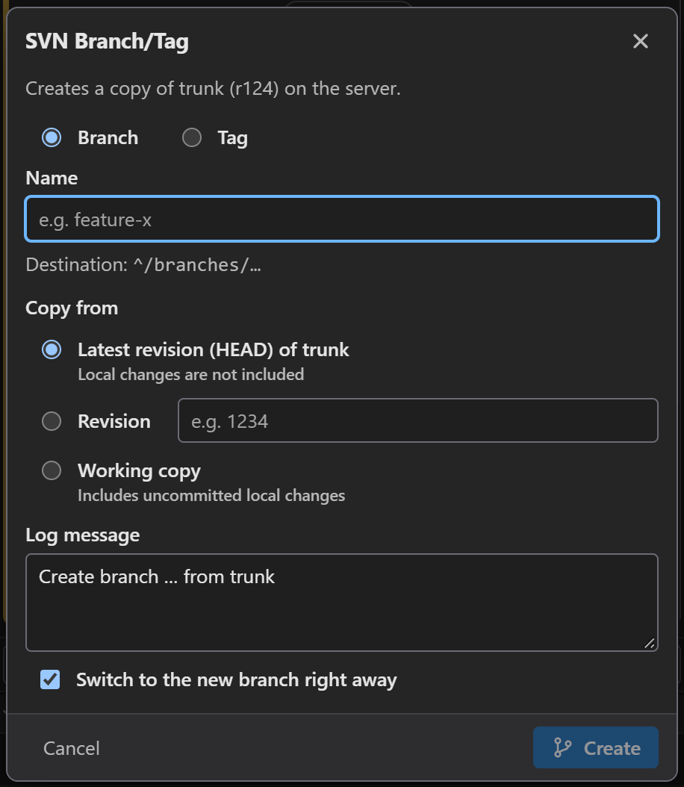
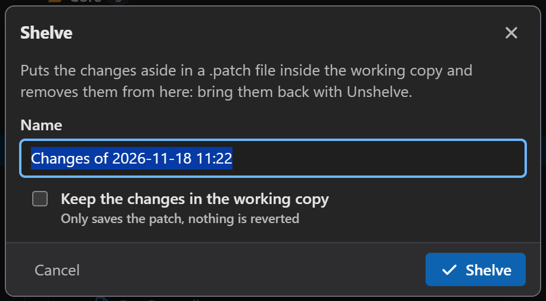
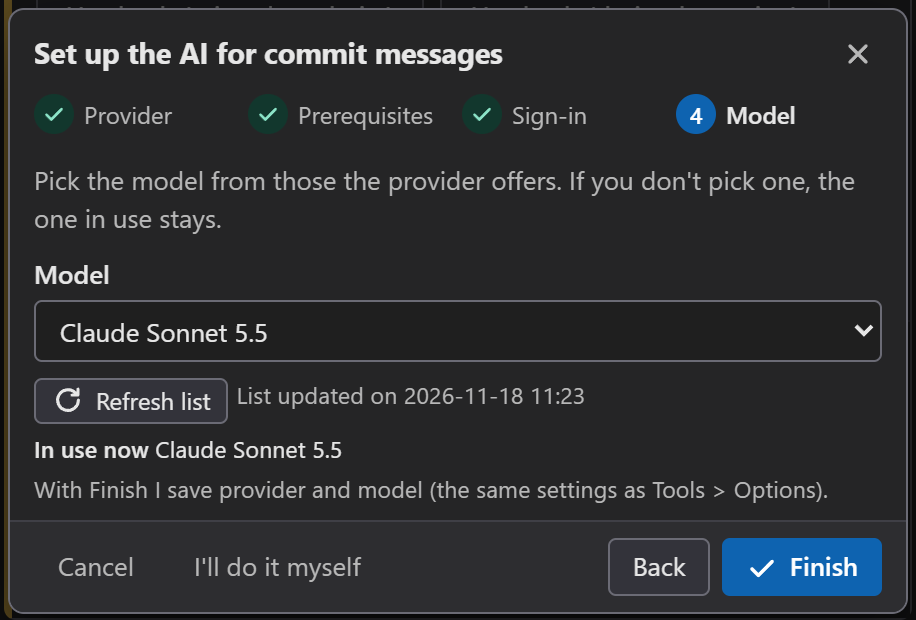

# Changelog

List of SVNAssist changes by version, from the most recent to the oldest. Button, menu and window names are those of the interface, in English. Entries marked "(to be verified)" are declared but not yet tested in Visual Studio.

## 0.6.1 (in preparation)

Contents: summary of incoming revisions based on the real changes, Copilot AI credits. Installs over 0.6.0.

Installation: same as 0.2.0. Not tested in Visual Studio (to be verified).

### Changes

- **The summary of incoming revisions explains what came in.** Before: it said that files had been modified. Now: it reads the real changes of each revision (`svn diff`) and says, naming the author, what changes in the behavior of the code, for example "Andrea removed the bottleneck from the message queue". No more lists of files. With many revisions the summary says how many it is based on (to be verified).
  - The AI now receives log messages and the changes (diff) of the revisions; for sensitive files (`.env`, keys, certificates) only the name. The text under the summary and the option description say so.
- **GitHub Copilot AI credits.** With **Show model and cost in the generated message** the Copilot status line shows model, tokens and AI credits spent (the ones you see on GitHub), for example "gpt-6-luna · 1,200 tokens in / 300 out · 0.25 AI credits". If Copilot does not report them nothing is written, never zero; if it reports them only for some calls it writes "≥ … (partial)" (to be verified, including the credit conversion).

### Fixes

- **Options choices no longer go back to Automatic.** Before: changing the interface language after saving could send provider, commit language and theme back to Automatic. Now: the choice stays (to be verified).

## 0.6.0 (2026-11-18)

Contents: AI explanation of incoming revisions before SVN Update (option), AI model and usage in one readable line, Gemini as an AI provider, Open this revision's file in the editor, Copy repository path, confirmation on the diff Undo button.

Installation: same as 0.2.0. Not tested in Visual Studio before release (to be verified).

### New

- **Explanation of incoming revisions before SVN Update.** With the option **Explain incoming revisions before SVN Update** (Tools > Options > Commit message AI, off by default) SVN Update first shows the revisions about to come in: author, date, message and touched files (A/M/D). Then you can choose **Update now** or **Cancel**.
  - The **Generate AI summary** button (then **Regenerate**) asks the AI to explain in plain words what changes and what the risks are. It runs only on click: if you don't press it, the AI is never called.
  - The summary uses the commit message language chosen in Changes.
  - Under the summary you see the model used (the commit one) and how much it consumed.
  - Only log messages and file names are sent to the AI, never file contents. With many revisions the summary says how many it is based on.
  - **Update now** and **Cancel** stay enabled while the summary is being prepared and stop it.
  - With the option off, SVN Update starts right away as before. It applies to the Changes command, not to Update from Solution Explorer or to merge (to be verified).
- **Gemini as an AI provider.** Chosen in the wizard and in Tools > Options, with a Google AI Studio key. The model list comes from Google. "Automatic" never picks it by itself, so the shared key doesn't go to Google by mistake (to be verified).
- **Open this revision's file in the editor.** In the Log, from the revision menu (if it touches a single file) or from the right-click on the file row, opens the file as it was in that revision, read-only and with language colors. If the file is deleted it opens the previous version. Binary files don't open and a message says so (to be verified).
- **Copy repository path.** In the Log menu, copies `path@rN` of the revision's files, one per line.

### Changes

- **AI model and usage in one readable line.** With **Show model and cost in the generated message** the status line reads for example "Sonnet 5.5 · 1,240 tokens in / 310 out · ≈ $0.04". With Claude Code the cost is shown too; with Claude API and OpenAI-compatible only tokens (to be verified with real providers).
- **Undo in the diff asks for confirmation.** The Undo button next to a diff block asks for confirmation before restoring the block to the BASE version (to be verified).
- **MessagePack security warnings fixed.** The backend uses an updated version.

## 0.5.0 (2026-11-18)

Contents: Branch/Tag, Create Patch, Apply Patch, Shelve, server checks at commit, locks by other users, conflict resolution by group, list of AI models from the provider, AI sign-in to redo with a button, model and cost in the generated message (option), Merge from folder, Merge applied one revision at a time.

Installation: same as 0.2.0. Tested on Visual Studio 18 (2026). Visual Studio 2022 (17.x) is declared as supported but not tested (to be verified).

### New

- **SVN Branch/Tag...** Creates a branch or a tag on the server from HEAD of the current branch, from a revision or from the working copy (with the local changes). It opens from the SVNAssist menu, from "More actions" in Changes and from the Switch selector.
  - The log message is pre-filled.
  - The option **Switch to the new branch right away** runs the switch after creation.
  - The name is checked. If it already exists, an error appears and the dialog stays open.

  

  *The SVN Branch/Tag dialog.*
- **Repository layout detected automatically.** If the URL does not match the layout set in the Options, SVNAssist recognizes the trunk/main, branches/branch and tags/tag folders. The detected layout is used by Switch, Merge, Branch/Tag and the branch label.
- **Create Patch... and Apply Patch...**
  - Create Patch saves the changes of a section, a file or a selection to a .patch file. It also includes unversioned files, as new files. Binary files and empty files are not included in the patch and are reported.
  - Apply Patch shows a preview with the files touched, the rejects and the conflicts, and applies the patch after confirmation.
  - Patches use relative paths and can also be applied to another working copy.
- **Shelve... / Unshelve.** Sets the changes aside, like git stash.
  - Asks for a name and the option **Keep the changes in the working copy**.
  - The **Shelved (n)** section in Changes lists the saved sets. The menu has Unshelve, Apply and keep, Save as .patch and Delete.
  - Binary files and empty files stay where they are; the warning before proceeding gives the reason for each file: (empty), (binary) or (open in another program).

  

  *The Shelve dialog, opened from the right-click menu on a file.*
- **Backup before mass reverts.** Before Revert everything and Undo merge, the local changes are saved in a hidden folder of the working copy, which does not appear among the unversioned files.
  - After the operation the **Restore changes** button reapplies them.
  - The backup is deleted after the restore or at the next operation. Backups older than 7 days or over 200 MB are deleted at startup.
  - If there is not enough disk space, SVNAssist asks whether to proceed without a backup.
- **Server check at commit.** Before the commit SVNAssist checks whether there are revisions from other users on the branch. In that case it warns that the working copy does not contain them and offers SVN Update. If the commit happens anyway, after the commit a warning and the **SVN Update now** button appear; the revision indicator stays orange.
- **Warning on conflict markers.** At commit, if a file contains conflict markers (even indented), a warning appears asking for confirmation.
- **Locks by other users.** In Changes a lock with "Locked by <user>" marks the files locked by others; the tooltip shows the date and the comment. It is updated by the periodic check for new revisions.
- **Use mine for all / Use theirs for all.** Resolve the text conflicts together, with confirmation and a list of files. Tree and property conflicts are excluded.
- **Use both.** In the resolution of a text conflict, merges the two versions: mine followed by theirs, or theirs followed by mine. Also available for all conflicts.
- **Mark as resolved on the open file.** When a conflicted file is open in Visual Studio, a bar above the document offers Mark as resolved, Use mine, Use theirs, Use both and Open merge editor (to be verified).
- **Right-click menu.** In the Conflicts panel of Changes and in the Log, right-click on the selected rows opens a menu of actions (also with Shift+F10 or the Menu key). For conflicts it includes Open file and Copy path. The Changes row menu also includes opening the file in File Explorer.
- **AI models from the provider.** The model selection shows the list returned by the provider, without "recommended" entries.
  - **Refresh list** rereads the list; otherwise it is reread after 24 hours.
  - **Other…** lets you type the name of a model that is not in the list.
  - The list always comes from the connected provider: SVNAssist has no model lists of its own. If the provider is not connected or does not answer, the list shows "Not connected" with a prompt to connect it. With Claude Code (subscription) the list needs an Anthropic API key. In Tools > Options the model is a text field.
  - With GitHub Copilot the estimated cost per commit (premium multiplier), the default model, the model used and the connected account are shown.
  - If the model does not respond, the error reports the reason given by the provider and suggests an action.
  - **Sign in again.** If generation fails because the provider sign-in has expired or is missing (expired session, not connected, invalid key), the **Sign in again** button appears next to the error. It opens the setup on the Sign-in step: with GitHub Copilot and Claude Code it starts the login in a terminal right away, with an API key it lets you paste a new one. At the end, Finish regenerates the message.
  - **Show model and cost in the generated message.** Option in Tools > Options > SVNAssist > Commit message AI, off by default. When on, the status line after Generate with AI shows the model used and the cost declared by the provider (with GitHub Copilot, premium requests). If the provider does not declare a valid cost, "cost not available" appears: SVNAssist never estimates a cost. With the option off, only Copilot shows the model used.

  

  *The Model step of the setup: the list comes from the provider.*
  - Not tested with the real providers (to be verified).
- **Merge from a folder.** SVN Merge... from a folder in Solution Explorer works only on that subtree. A verdict shows whether the folder is Compatible with the merge or whether the merge is not possible.
- **Files of each revision.** In the selection of the revisions to merge, below the table a list of the files involved appears (A, M, D). A click on a file opens the diff of that revision.
- **Merge preview by revision.** The preview is grouped by revision, with the files of each one. Files with a predicted conflict are marked with a red C and with the number of possible conflicts.
- **Show Log: changed paths.** For the selected revision, the Log lists the changed paths with the counts by action. The option **Only affected paths** hides the paths outside the file or folder from which the Log was opened.
- **Merge with pending changes.** The merge is no longer blocked by uncommitted changes. A warning appears with the number of changed items and the files in common with the merge. Before the merge the changes are copied to a safety folder. Undo merge restores the pending changes as well as undoing the merge. After the merge commit the copy is deleted (to be verified).
- **Merge applied one revision at a time.** The merge proceeds with the progress "revision N of TOT (rNNNNN)". If a revision conflicts, the merge stops.
  - The message states what has been applied, what remains and what to do: resolve the conflicts, mark them as resolved, choose Continue merge. The merge does not need to be redone.
  - **Continue merge** applies only the remaining revisions.
  - The state is saved to disk: the merge can be resumed after restarting Visual Studio.
  - The "Merge interrupted" banner in Changes and in the Log shows applied, remaining and steps to take, with the buttons Continue merge, Undo merge and Discard state.
- **Progress with percentage.** Switch, Update and Update to revision show a bar with percentage and "N of about M items" when the total can be determined (maximum wait of 10 seconds). Otherwise the indeterminate bar remains.
- **Update to revision with progress window** and a Cancel button.
- **More complete status.** Changes recognizes property conflicts, obstructed items, incomplete items and tree conflicts.
- **AI limits per provider.** The length of the diff sent and of the response depend on the provider, instead of a single limit applied to all.

### Changes

- **Update to revision.** The list shows only the revisions of the current branch.
- **Mark as resolved.** If the file is identical to the base version (for example because the choice was removed in the merge editor), SVNAssist warns before proceeding.
- **Merge.** Revisions are read without the list of files, in parallel and cached. The timing of each phase is written to the SVNAssist log. The effect on merge time has not been measured (to be verified).

### Fixes

- **Recent.** Before: clicking an entry in Recent did not select or write the text; it appeared only after pressing another button. Now: the chosen text appears in the field immediately.
- **Merge progress.** Before: it appeared twice, in the Changes window and in the Log tab. Now: the full window is shown only in the view from which the operation starts; in the other one a strip appears that does not block.
- **Progress while idle.** Before: the progress window showed "0 items" before the start. Now: it shows a text indicating the wait.
- **Merge stopped by a conflict.** Before: the error appeared several times and Changes did not refresh. Now: Changes shows the Conflicts section and only one message appears.
- **Update to revision.** Before: choosing a revision earlier than the creation of the branch gave an error. Now: the list contains only the revisions of the branch.
- **Create Patch with files open in other programs.** Before: if the selected unversioned items included a file open exclusively (for example in the Visual Studio .vs folder), the patch was not created ("The process cannot access the file"). Now: the .vs folder is not part of the patch and a file open in another program is reported among the excluded ones.
- **Conflict warning after a merge.** Before: after resolving the conflicts in Changes, the merge result kept showing "N in conflict". Now: the number follows the real state of the working copy and the warning disappears when no conflicts remain.
- **Login from the terminal.** Before: the terminal opened by Sign in (for example for Claude Code) closed immediately. Now: it stays open.

## 0.4.0 (2026-11-15)

Contents: Solution Explorer (status icons, SVN Add, Show Log), Show Log options, multiple selection in Changes, Cleanup with options, progress window with Cancel, recovery of an interrupted switch. Includes the changes of 0.3.2, which was not released separately.

Installation: same as 0.2.0.

### New

- **Multiple selection in Changes.** Ctrl+click adds or removes an item, Shift+click selects a range (also across sections). From the keyboard: Shift+arrows, Ctrl+Space, Ctrl+A. Right-click shows the actions valid for the whole selection, with the count. Space and Delete apply to all selected items.
- **Delete on folders.** A versioned folder is deleted with svn delete (still to be committed); an unversioned one goes to the Recycle Bin. The confirmation lists the items.
- **AI: Shorter and More detailed.** The commit message menu has these two entries in addition to Generate.
- **Show Log: Stop on copy/rename.** The option is off by default: the Log shows the full history beyond copies and renames.
- **Show Log: Include merged revisions.** Revisions brought in by a merge are nested under the merge; a reverse merge is marked.
- **Show Log: diff of the files of a revision.** A click on a file of a revision opens the diff of that revision, also for merged revisions. The options can be changed while the Log is open and the Log reloads.
- **SVN status icons in Solution Explorer.** Normal, modified, added, unversioned, conflict, deleted. They are on by default and can be turned off in Options. SVNAssist registers as a source control provider only for solutions inside an SVN working copy.
- **Solution Explorer menu.**
  - **Show Log** for files, folders and projects.
  - **SVN Add** for unversioned items, also with multiple selection.
  - **Check for Modifications** for modified files: opens the Visual Studio diff against BASE.
- **Warning before Switch.** If the working copy has changes, a warning appears with the counts by type and three choices: Continue anyway, Open Cleanup, Cancel.
- **Cleanup with options.** From every starting point: Break locks, Fix timestamps, Vacuum pristines, Include externals. The destructive options (Delete unversioned, Delete ignored, Revert) are in red and ask for confirmation.
  - Delete unversioned and Delete ignored always skip the .vs folder and the files kept open by Visual Studio or by debugging. The summary shows "Deleted N, skipped M in use".
  - With svn versions earlier than 1.9, the options beyond the simple cleanup are disabled.
- **Progress window** for Switch, Update and Merge. It shows the current phase, the svn lines in sequence and the highlighted conflicts. The final summary has the **Open the conflicts** button. The progress has no percentage: indeterminate bar and counter.
- **Cancel in Switch, Update and Merge.**
  - Switch or update cancelled: runs a cleanup, warns that the working copy may be half-done and offers Cleanup..., Complete switch or Go back to before the switch (for update, Retry update).
  - Merge cancelled: offers to revert the merge changes (with confirmation) or Leave as is.
- **Go back to before the switch.** Restores the URL and the starting revision, saved before the switch. The local changes remain.
- **Prerequisites without restarting the PC.** After installing svn, .NET or the command line AI tools, SVNAssist reads the updated PATH again. If a program is present but does not start, the message asks to restart Visual Studio.

### Changes

- **.vs folder.** It stays among the unversioned items, so it can be ignored, but it does not make the working copy modified. Commit All and the Switch warning do not consider it.
- **Commit All with new files.** If there are unversioned files, it asks "Add them to the commit?" with the choices: Yes, add and commit; No, versioned files only; Cancel. The question also appears when there are only new files. Commit Staged does not change.
- **Show Log.** The list starts from HEAD, as in TortoiseSVN.
- **Switch errors.** Multi-line errors are shown in full and can be copied.

### Fixes

- **Show Log after a commit.** Before: the commit just made did not appear without an update. Now: it appears immediately.
- **"Incomplete switch".** Before: the entry remained even when the working copy was consistent. Now: it is removed automatically if the URL is the starting or destination one and there are no switched or incomplete folders and no locks.
- **Switch interrupted by E155009** (included in 0.3.2). Before: svn stopped halfway when a folder was held open (by Visual Studio, by the designer or by an antivirus); the error appeared on a truncated line, the header showed the old branch, the selector marked the new one as "(current)" and refused to repeat the switch. Now:
  - SVNAssist runs cleanup, waits 2 seconds and repeats the switch once.
  - If the switch remains halfway, the error says so and advises not to use Revert. The **Complete switch** button runs cleanup and the same switch.
  - The header shows "branch (incomplete switch)" and the selector shows the destination as "(incomplete switch)". The state remains after Visual Studio is closed.
  - A failed switch that does not touch the working copy (wrong URL, credentials) remains a normal error.
  - The E155009 error offers Run Cleanup also outside the switch.
- **Single-line errors.** Before: long errors appeared truncated on one line. Now: they wrap in the bottom bar.

## 0.3.1 (2026-11-12)

Contents: fixes to Cancel lines, check for new revisions and log files. It installs over 0.3.0.

Installation: same as 0.2.0.

### Changes

- **Host log.** The log is written to the SVNAssist log folder, one file per day. Several Visual Studio instances can write to it at the same time. The old log file is no longer used.
- **Diagnostics for the Cancel button in the diff.** The log records the roles of the view, whether the viewer was found, the number of differences and the number of buttons created.

### Fixes

- **Ctrl+Z after Cancel lines.** Before: Ctrl+Z did not undo the operation if the file was open. Now: if the file is open (editor or diff), the change is applied to the buffer as a single undoable operation and then saved. If the file is not open, it is written to disk as before.
- **Checking for new revisions.** Before: it also ran with Visual Studio in the background. Now: it does not run in the background; when the window returns to the foreground it checks immediately whether the last check is older than the interval.

Known limitations:

- The Cancel button next to the diff blocks has not been verified in Visual Studio (to be verified).
- A file open only as a panel of a diff, without its own editor window, is still rewritten on disk: Ctrl+Z does not undo it.
- With unsaved changes, the "next / previous change" lines may move.

## 0.3.0 (2026-11-12)

Contents: Switch, Merge from a branch, conflict resolution, Cancel lines in the diff, revision indicator, Recent, Generate with AI on all changes.

Installation: same as 0.2.0. If 0.2.0 is installed, it is updated. svn client 1.8 or later.

### New

- **Switch.** The current branch is always visible in SVN Changes. **Switch...** opens from Changes or from Extensions > SVNAssist.
  - The selector shows the recently used items and has a search.
  - The extended view, for repositories with hundreds of branches and tags, has filters by name, type, author and period, and sorting by name, date, revision or author.
  - The repository layout (trunk/branches/tags) can be configured, including with the project at the root or in a subfolder.
- **SVN Merge...** Choose the branch. The Log opens as a document with only the revisions to merge.
  - **Preview** runs a simulation without modifying files.
  - **Merge all** and **Merge selected** (cherry-pick).
  - If the working copy has changes or mixed revisions, a message explains it and offers **SVN Revert everything…** and **SVN Update now**.
  - **Undo merge** from the banner, with confirmation and a list of files.
  - The message in the style of TortoiseSVN ("Merged revision(s) 8-10 from …") is saved in Recent.
- **Conflicts.** The Conflicts panel in SVN Changes offers for each file: **Open merge editor** (Visual Studio 3-way editor), **Use mine**, **Use theirs**, **Mark as resolved**.
  - Tree conflicts are grouped, with **Mark all as resolved**.
  - The auxiliary files created by svn are placed under the conflicted file and not among the unversioned files.
- **Cancel individual lines.** A Cancel button next to each diff block, or right-click > **SVN: Revert Selected Changes** on a selection. The button has not been verified in all Visual Studio diff views (to be verified).
- **Next / previous change in the diff.** Alt+F8 and Shift+Alt+F8. The shortcuts can be changed in the options.
- **Revision indicator.** At the bottom of SVN Changes: green if the working copy is at the latest revision; orange, with "rN available — SVN Update", if others have committed. The check is read-only and runs every 5 minutes; the interval can be changed or disabled in Tools > Options.
- **Recent.** Panel with search and preview of the last 25 commit messages per repository.
- **Revert everything per section.** Right-click on Changes or on Staged offers **SVN Revert everything…**, with confirmation.
- **Generate with AI on all changes.** Large diffs are split into blocks, summarized and combined into a single message (title and a list by area), also with hundreds of files. The message follows the project's commit rules and the global ones, for example Conventional Commits.

### Changes

- The Log always opens in the document area, next to the diffs.
- Double-clicking an added or unversioned file opens the whole file.
- Result messages disappear after a few seconds; errors stay.
- The SVN submenu in Solution Explorer has been removed, because the actions are available in SVN Changes.

### Fixes

- **Generate with AI, Copilot.** Before: error "No response was returned". Now: a new attempt with a smaller request and an error message.
- **Generate with AI, OpenAI-compatible providers.** Before: error "'0' is an invalid start of a value". Now: a new attempt with a smaller request and an error message.
- **Generate with AI, format.** Before: the generated message was wrapped in a code block. Now: the code block is not added.
- **Windows restored at startup.** Before: a SVNAssist window restored by Visual Studio could show the error "Failed to find the tool window". Now: if the window cannot be created, the reason appears in the window itself.

Known limitations:

- Create branch/tag and a guided merge wizard are not present.
- On very slow repositories Switch and Merge have no progress indicator.
- Tested on Visual Studio 2026 (18.x); Visual Studio 2022 declared, not tested (to be verified).

## 0.2.0 (2026-11-12)

Contents: SVN Changes panel, Log as a document, Visual Studio diff, Update to revision, Cleanup, Lock / Unlock, SVN login, AI setup wizard, themes, language.

### New

- **SVN Changes panel in Git style.** Shows the files in a tree, with the sections Staged, Changes and Unversioned. The panel has a filter and can be used from the keyboard (arrows, Space, Enter; Delete removes with confirmation). The commit button is "Commit All" if Staged is empty, otherwise "Commit Staged (n)", where n is the number of files in Staged. Each action shows a status message.
- **Log as a document.** Show Log opens as a document in the Visual Studio editor area, with a table of revisions. Filters by author, text, path and dates. For each revision the changed files are listed. Ctrl+click on two revisions compares them. The command is also available for files and folders from Solution Explorer.
- **Visual Studio diff.** Differences between the working copy, revisions and folders open in the Visual Studio viewer. TortoiseSVN is not required for the diff.
- **Update to revision, Cleanup, Lock / Unlock.**
  - "SVN Update to revision": choose the revision from a list.
  - "SVN Cleanup": Visual Studio menu command. If the working copy is locked, the Cleanup button also appears.
  - "Lock / Unlock": locks and unlocks files.
- **SVN login.** The password is asked only if the one saved in the Subversion cache is missing or expired. With Windows integrated authentication it is never asked. The cache is the same one used by TortoiseSVN.
- **AI setup wizard.** Steps: choice of the service (GitHub Copilot, Claude Code, Claude API, GitHub Models), installation of missing prerequisites, sign-in, choice of the model. It reopens from Extensions > SVNAssist > "Change AI Provider...". Prerequisites are shown in green or red and are clickable. For GitHub Models the model used is openai/gpt-4o-mini.
- **Themes.** Light, Dark, Blue or High Contrast. The change applies without restarting Visual Studio.
- **Language.** Italian or English, from Extensions > SVNAssist > Language / Lingua or from Tools > Options. "Automatic" follows the Visual Studio language. The change applies without restarting Visual Studio and covers windows, service messages, dialogs and settings. SVN command names and svn program messages do not change. The language of AI-generated commit messages is a separate setting.

### Changes

- **AI models from a drop-down menu.** The model is chosen from a drop-down (Claude, Copilot, GitHub Models). The default Claude model is Sonnet. Before: the default was Opus.
- **Prerequisites per provider.** The wizard shows only the prerequisites of the chosen service, with notes on sign-in, key and cost.
- **Saved model no longer in the list.** If the saved model no longer appears in the list, the default model is used.
- **Menu entries in English.** "Change AI Provider...", "Diff with BASE", "Show Log" and "Add to Ignore List" use standard SVN English.

### Fixes

- **Dark and Blue themes.** Before: black text on a black background. Now: the Changes and Log windows use the Visual Studio colors.
- **Generate with AI.**
  - Errors and cancellations. Before: "OK" was shown with no message. Now: the reason appears in the status bar.
  - Sign-in. Before: after the popup was closed once, nothing opened anymore. Now: the popup appears again at each attempt.
  - AI not configured. It suggests signing in from the terminal (with GitHub CLI or Claude Code), or a token as an alternative.
  - Added, deleted, empty or binary files appear in the generated commit message.
  - With many modified files the generation works, because the diff is compacted.
  - Follows the commit rules defined in the project instructions for GitHub Copilot and in the personal ones for Copilot.
- **Select all.** Before: it also selected unversioned files in the build folders (bin, obj). Now: it selects only the Changes section.
- **Working Copy Path.** The path set in Working Copy Path takes precedence over automatic detection, including in the Log.
- **Operation already in progress.** Before: a second click did nothing. Now: it shows "Operation in progress...".
- **Right-click menu.** The entries update when the state of a file changes.

## Version 0.1.0

Version 0.1.0 is deprecated and replaced by 0.2.0: uninstall it and install 0.2.0. It has no section of its own.
