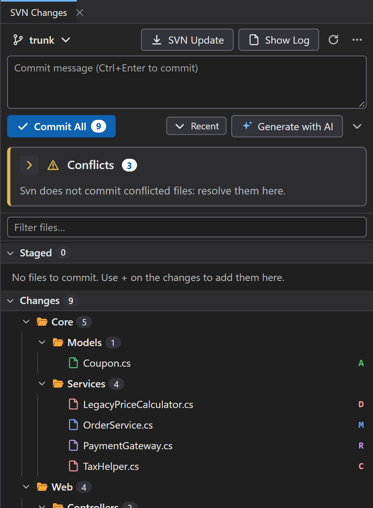

# SVNAssist

**Subversion inside Visual Studio.** See what you changed, write the message (with AI if you like), commit, merge branches and resolve conflicts without leaving the IDE.

[Italiano](README.md) · English

-blue)




## What it is for

If your project lives in an SVN repository and you work in Visual Studio, you probably switch between the IDE, TortoiseSVN and the command line. SVNAssist puts everyday operations in a panel next to your code, with the behaviour of `svn.exe` and the comfort of Git Changes. It does not replace SVN: it uses it and guides you through it.

## How to use it

1. Open a solution that lives in an SVN working copy.
2. **Extensions > SVNAssist > SVN Changes**: your changes appear grouped by folder.
3. Tick what you want to commit, write the message (or press **Generate with AI**) and press **Commit**.

Everything else is one click away:

| I want to... | Where |
|--------------|-------|
| update, see the history | **SVN Update**, **Show Log** at the top of the panel |
| change branch | the branch name at the top: **Switch** with list, recents and filters |
| create a branch or a tag | **...** menu > **SVN Branch/Tag...** |
| merge a branch | **Show Log** > pick the revisions > **SVN Merge...**, or right-click a folder |
| resolve a conflict | **Conflicts** section of the panel (mine, theirs, both, 3-way editor) |
| put work aside | right-click > **Shelve...**; take it back from **Shelved** |
| exchange changes without committing | **Create Patch...** and **Apply Patch...** |
| undo a single line of a diff | **SVN: Revert Selected Changes** in the Visual Studio diff |

SVNAssist warns you before things go wrong: revisions by others you have not downloaded yet, files with conflict markers, local changes that a revert or a merge would wipe (they are saved in a backup).

## Commit messages with AI

**Generate with AI** reads the diff of the files you are about to commit and writes the message; **Improve** polishes a draft of yours. A project can set its own rules in `.github/copilot-instructions.md`.

| Provider | What you need |
|----------|--------------|
| GitHub Copilot | a Copilot subscription and `gh auth login` |
| Claude Code | Claude Code installed and signed in (subscription) |
| Claude API | an Anthropic API key |
| OpenAI-compatible | endpoint and API key: GitHub Models (default), OpenAI, Azure, Ollama, Gemini |

With `auto` it tries the providers in order and moves to the next one if one fails. The list of models comes from the connected provider. A guided setup walks you through the choice (**Extensions > SVNAssist > Change AI Provider...**), and if your sign-in expires a **Sign in again** button appears.

For privacy, the diff leaves your computer only after you confirm, and each credential goes only to its own service.

## Installation

You need:
- **Visual Studio 2026 (18.x)**. Visual Studio 2022 is declared as supported but has not been tried.
- **`svn.exe`** in the PATH (from TortoiseSVN with the command line tools, SlikSVN or CollabNet).
- **.NET 10 runtime** (if missing, SVNAssist offers to install it).

Then download **`SVNAssist.vsix`** from the [Releases page](https://github.com/PignaBoyz/SVNAssist/releases), double-click it and restart Visual Studio. If a requirement is missing, the **Prerequisites** button at the bottom of the panel turns red and guides you through fixing it.

Every Release also contains a demo of the interface that opens in the browser.

## Settings

**Tools > Options > SVNAssist**. You usually do not need to touch them: the working copy is detected from the solution and AI is set up from the guided setup.

| Setting | Default | Notes |
|---------|---------|-------|
| AI Provider | `auto` | `auto`, `copilot`, `claudecode`, `claude`, `openai` |
| Show model and cost in the generated message | off | the cost is the one declared by the provider; if missing, "cost not available" |
| Commit message language | `auto` | `auto`, `italiano`, `english` |
| Repo layout | `trunk/branches/tags` | if the URL does not match it is detected |
| New revision check (minutes) | 5 | checks for new revisions on the branch; 0 = off |
| Working Copy Path | empty | takes precedence over detection |

Interface language (Italian or English) and theme are in the **Extensions > SVNAssist** menu. Full list: [docs/ui-protocol.md](docs/ui-protocol.md) (in Italian).

## Known limits

- Visual Studio 2022 has not been tried.
- Solution Explorer keeps the standard Visual Studio status icons.
- Model lists are not yet verified with every real provider.

## Documentation

| For... | Read |
|--------|------|
| the changes of each version | [CHANGELOG.en.md](CHANGELOG.en.md) · [Italiano](CHANGELOG.md) |
| features in detail | [docs/FUNZIONALITA.md](docs/FUNZIONALITA.md) (Italian) |
| the architecture | [DESIGN.md](DESIGN.md), [docs/host.md](docs/host.md) (Italian) |
| what comes next | [docs/ROADMAP.md](docs/ROADMAP.md) (Italian) |

## For developers

The **Host** (`src/SVNAssist.Host`, net472) is the Visual Studio package with WebView2 windows. The **backend** (`src/SVNAssist.Backend`, .NET 10) runs `svn.exe` and talks to the AI providers, connected to the Host with StreamJsonRpc. The interface (`src/SVNAssist.UI.Web`) is the same as the demo.

```bash
dotnet test tests/SVNAssist.Tests/SVNAssist.Tests.csproj
node --test tests/ui-web/*.test.mjs
node tools/build-demo.mjs
```

Integration tests need `svn.exe` in the PATH. The VSIX is built as described in [docs/host.md](docs/host.md); `tools/collaudo-mirato.ps1` installs it in an experimental instance with a test repository. How release notes and changelogs are written: [docs/release-notes/GUIDA.md](docs/release-notes/GUIDA.md).

## License

See [LICENSE](LICENSE).
