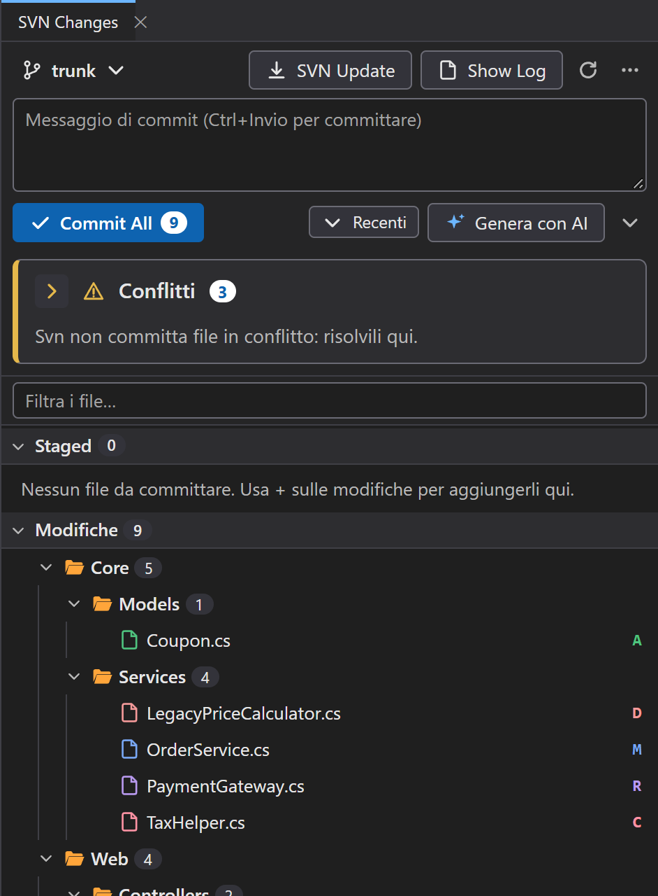

# SVNAssist

**Subversion dentro Visual Studio.** Vedi cosa hai modificato, scrivi il messaggio (anche con l'AI), committi, unisci i rami e risolvi i conflitti senza lasciare l'IDE.

Italiano · [English](README.en.md)

-blue)




## A cosa serve

Se il tuo progetto sta in un repository SVN e lavori con Visual Studio, di solito alterni IDE, TortoiseSVN e riga di comando. SVNAssist mette le operazioni di ogni giorno in un pannello accanto al codice, con il comportamento di `svn.exe` e la comodità di Git Changes. Non sostituisce SVN: lo usa e lo guida.

## Come si usa

1. Apri una solution che sta in una working copy SVN.
2. **Extensions > SVNAssist > SVN Changes**: le modifiche compaiono raggruppate per cartella.
3. Spunta ciò che vuoi committare, scrivi il messaggio (o premi **Genera con AI**) e premi **Commit**.

Il resto sta a un click di distanza:

| Voglio... | Dove |
|-----------|------|
| aggiornare, vedere la cronologia | **SVN Update**, **Show Log** in alto nel pannello |
| cambiare ramo | il nome del ramo in alto: **Switch** con elenco, recenti e filtri |
| creare un branch o un tag | menu **...** > **SVN Branch/Tag...** |
| unire un ramo | **Show Log** > selezione delle revisioni > **SVN Merge...**, oppure tasto destro su una cartella |
| risolvere un conflitto | riquadro **Conflitti** del pannello (mia, loro, entrambe, editor a 3 vie) |
| mettere da parte il lavoro | tasto destro > **Shelve...**; si riprende da **Shelved** |
| scambiare modifiche senza committare | **Create Patch...** e **Apply Patch...** |
| annullare una riga di un diff | **SVN: Revert Selected Changes** nel diff di Visual Studio |

SVNAssist avvisa prima dei guai: revisioni di altri non ancora scaricate, file con marcatori di conflitto, modifiche locali che un revert o un merge porterebbe via (le salva in un backup).

## Messaggi di commit con l'AI

**Genera con AI** legge il diff dei file che stai per committare e scrive il messaggio; **Migliora** rifinisce una bozza tua. Il progetto può imporre le sue regole in `.github/copilot-instructions.md`.

| Provider | Cosa serve |
|----------|-----------|
| GitHub Copilot | abbonamento Copilot e `gh auth login` |
| Claude Code | Claude Code installato, con login (abbonamento) |
| Claude API | API key Anthropic |
| Compatibile OpenAI | endpoint e API key: GitHub Models (di default), OpenAI, Azure, Ollama, Gemini |

Con `auto` prova i provider in ordine e passa al successivo se uno fallisce. L'elenco dei modelli viene dal provider collegato. Una procedura guidata ti accompagna nella scelta (**Extensions > SVNAssist > Change AI Provider...**), e se l'accesso scade compare **Rifai l'accesso**.

Per privacy, il diff lascia il computer solo dopo la tua conferma, e ogni credenziale va solo al proprio servizio.

## Installazione

Servono:
- **Visual Studio 2026 (18.x)**. Dalla 0.8.0 Visual Studio 2022 non è più supportato (opzioni moderne di VS 2026).
- **`svn.exe`** nel PATH (da TortoiseSVN con i command line tools, SlikSVN o CollabNet).
- **Runtime .NET 10** (se manca, SVNAssist propone l'installazione).

Poi scarica **`SVNAssist.vsix`** dalla [pagina delle Release](https://github.com/PignaBoyz/SVNAssist/releases), doppio click e riavvia Visual Studio. Se manca un requisito, il pulsante **Prerequisiti** in fondo al pannello diventa rosso e guida la sistemazione.

Ogni Release contiene anche una demo dell'interfaccia che si apre nel browser.

## Impostazioni

**Tools > Options > SVNAssist**. Di solito non serve toccarle: la working copy è rilevata dalla solution e l'AI si configura dalla procedura guidata.

| Impostazione | Predefinito | Note |
|--------------|-------------|------|
| AI Provider | `auto` | `auto`, `copilot`, `claudecode`, `claude`, `openai` |
| Mostra modello e costo nel messaggio generato | spento | il costo è quello dichiarato dal provider; se manca, "costo non disponibile" |
| Lingua dei commit message | `auto` | `auto`, `italiano`, `english` |
| Repo layout | `trunk/branches/tags` | se l'URL non corrisponde viene rilevato |
| New revision check (minutes) | 5 | controllo di nuove revisioni sul ramo; 0 = spento |
| Working Copy Path | vuoto | ha la precedenza sul rilevamento |

Lingua dell'interfaccia (italiano o inglese) e tema sono nel menu **Extensions > SVNAssist**. Elenco completo: [docs/ui-protocol.md](docs/ui-protocol.md).

## Limiti noti

- In Solution Explorer restano le icone di stato standard di Visual Studio.
- Gli elenchi dei modelli non sono ancora verificati con tutti i provider reali.

## Documentazione

| Per... | Leggi |
|--------|-------|
| le modifiche di ogni versione | [CHANGELOG.md](CHANGELOG.md) · [English](CHANGELOG.en.md) |
| le funzioni nel dettaglio | [docs/FUNZIONALITA.md](docs/FUNZIONALITA.md) |
| l'architettura | [DESIGN.md](DESIGN.md), [docs/host.md](docs/host.md) |
| i prossimi passi | [docs/ROADMAP.md](docs/ROADMAP.md) |

## Per chi sviluppa

L'**Host** (`src/SVNAssist.Host`, net472) è il pacchetto Visual Studio con le finestre in WebView2. Il **backend** (`src/SVNAssist.Backend`, .NET 10) esegue `svn.exe` e parla con i provider AI, collegato all'Host con StreamJsonRpc. L'interfaccia (`src/SVNAssist.UI.Web`) è la stessa della demo.

```bash
dotnet test tests/SVNAssist.Tests/SVNAssist.Tests.csproj
node --test tests/ui-web/*.test.mjs
node tools/build-demo.mjs
```

I test di integrazione richiedono `svn.exe` nel PATH. Il VSIX si compila come in [docs/host.md](docs/host.md); `tools/collaudo-mirato.ps1` lo installa in un'istanza sperimentale con un repository di prova. Come si scrivono note di rilascio e changelog: [docs/release-notes/GUIDA.md](docs/release-notes/GUIDA.md).

## Licenza

Vedi [LICENSE](LICENSE).
