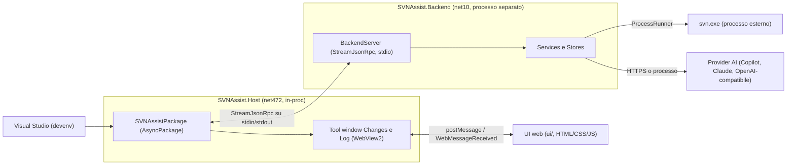

# SVNAssist — Stack tecnologico

Versione di riferimento: **0.3.2** (`Directory.Build.props`). Documento ricavato dai file di progetto,
dal codice e dalla CI; dove un documento storico non corrisponde al codice, vale il codice (vedi §9).

## 0. Riepilogo

| Area | Tecnologia | Versione / dettaglio |
|---|---|---|
| Host in-proc (VS) | .NET Framework | net472, `LangVersion` 12.0 |
| Host: pacchetto VS | VSSDK classico | `Microsoft.VisualStudio.SDK` 17.14.40265, `Microsoft.VSSDK.BuildTools` 17.14.2120 |
| Host: pacchetto VS | `AsyncPackage` + `.vsct` | nessun Community Toolkit |
| UI | WebView2 (WPF) | `Microsoft.Web.WebView2` 1.0.3967.48, runtime Evergreen di sistema |
| UI web | HTML / CSS / JavaScript vanilla | nessun framework, nessun `package.json` |
| Backend | .NET console, framework-dependent | net10.0, `LangVersion` 12.0, `Nullable` enable |
| RPC host ⇄ backend | StreamJsonRpc su stdio | 2.22.23 (host e backend) |
| SVN | `svn.exe` come processo esterno | `--non-interactive`, output `--xml`, `LC_ALL=C` |
| AI | Copilot, Claude Code, Claude API, OpenAI-compatibile | catena con fallback (`AiServiceFactory`) |
| Test backend | xUnit | 2.9.3 su net10.0 |
| Test UI | `node --test` | runner integrato in Node, nessuna dipendenza npm |
| Packaging | VSIX via MSBuild | `msbuild` / `msb.exe` su VS 18, manifest VSIX 2.0 |
| CI | GitHub Actions | `windows-latest`, .NET `10.0.x`, SlikSVN via Chocolatey |

---

## 1. Panoramica



In testo: **VS → Host (in-proc) → Backend (processo separato) → svn.exe**; in parallelo **Host ↔ WebView2 ↔ UI web**.

- Il **Host** è sottile: comandi, menu, finestre, dialoghi, relay di messaggi JSON. Non fa logica SVN.
- Il **Backend** contiene la logica (SVN, AI, stato della UI). Se cade, Visual Studio resta in piedi.
- La **UI web** è la stessa pagina usata dalla demo (`docs/demo/`).

---

## 2. Host (`src/SVNAssist.Host`)

- **Framework**: .NET Framework **net472**, `VssdkCompatibleExtension`, `UseWPF` e `UseWindowsForms` attivi.
- **Pacchetti** (da `SVNAssist.Host.csproj`):
  - `Microsoft.VisualStudio.SDK` 17.14.40265 (`ExcludeAssets="runtime"`: le DLL le fornisce VS);
  - `Microsoft.VSSDK.BuildTools` 17.14.2120;
  - `Microsoft.Web.WebView2` 1.0.3967.48 (senza asset `runtime`, `native`, `build`);
  - `StreamJsonRpc` 2.22.23 (senza asset `runtime`).
- **Community Toolkit**: non usato (nessun riferimento nel codice).
- **Package**: `SVNAssistPackage : AsyncPackage` con `ProvideAutoLoad` per `NoSolution` e `SolutionExists` (caricamento in background).
- **`.vsct`**: `src/SVNAssist.Host/SVNAssist.vsct`. Menu sotto **Extensions** (`MenuMain`, sottomenu lingua `MenuLang`),
  gruppi `GroupMainPrimary`/`GroupMainSecondary`, `GroupCode` (editor: Revert Selected Changes, Next/Previous Change),
  `GroupSe` (Esplora soluzioni: Show Log, SVN Add con `DynamicVisibility`). Comandi: Changes, Commit, Update,
  Log, Change AI Provider, Update to revision, Switch, Merge, Cleanup, Next/Previous Change, Revert Selected, ecc.
- **Tool window Changes**: `ChangesToolWindow : WebToolWindow`, `VsDockStyle.Tabbed`, nel gruppo di Solution Explorer, lato sinistro.
- **Log come documento**: `LogToolWindow`, `VsDockStyle.MDI`, `Transient = true`. È un'unica istanza nell'area editor
  (come i diff); il titolo è `Log: <percorso>`.
- **Pagina Options**: `SvnAssistOptions : DialogPage` in Tools → Options → SVNAssist (pagina `General`). Le API key sono
  cifrate con **DPAPI** (utente corrente) nelle impostazioni di VS.
- **Provider SCC**: `SvnSccService` con `ProvideSourceControlProvider` e `ProvideService`. Serve solo i **glifi** di
  Solution Explorer (nessun comando); la mappa stato → glifo è in `src/Shared/SccGlyph.cs`.
- **Margine di annullamento nel diff**: `RevertMargin` (MEF, `IWpfTextViewMarginProvider`), registrato tramite asset
  `Microsoft.VisualStudio.MefComponent` nel manifest.
- **Backend process**: `BackendProcess` avvia `SVNAssist.Backend.exe` dalla cartella `backend/` del VSIX, lo mette in un
  **Job Object** con `KILL_ON_JOB_CLOSE` (muore con VS) e lo riavvia in caso di crash (massimo 4 volte al minuto).
- **Manifest**: `src/SVNAssist.Host/source.extension.vsixmanifest`. Identità `SVNAssist` `0.3.2`, editore `Andrea Pinelli`,
  target `Microsoft.VisualStudio.Community/Pro/Enterprise` `[17.0,19.0)`, architettura `amd64`,
  prerequisito `Microsoft.VisualStudio.Component.CoreEditor`. La versione deve coincidere con `Directory.Build.props`
  (la build fallisce se no).
- **Contenuto del VSIX**: `ui/` (= `src/SVNAssist.UI.Web` senza `contract/`) e `backend/` (publish del backend).
- **Log dell'host**: `%LOCALAPPDATA%\SVNAssist\host-log.txt`.

---

## 3. UI (`src/SVNAssist.UI.Web`)

- **WebView2**: pacchetto `Microsoft.Web.WebView2` 1.0.3967.48 (lato host). Il runtime è quello **Evergreen** installato
  sulla macchina; non è incluso nel VSIX. Se manca, l'host mostra un messaggio con il link al download.
  - User data folder: `%LOCALAPPDATA%\SVNAssist\WebView2`, ambiente condiviso tra le due finestre.
  - Pagina servita con `SetVirtualHostNameToFolderMapping` (`DenyCors`); navigazione fuori dall'origine bloccata.
- **Tecnologia**: HTML, CSS e JavaScript **vanilla**. Nessun framework, nessun bundler, nessun `package.json`.
  Gli script sono in `js/` come file classici con IIFE che estendono `window.SVNUI`.
- **Struttura**:
  - `index.html` (con CSP stretta: `default-src 'none'`, `script-src 'self'`, `connect-src 'none'`);
  - `css/tokens.css` (variabili di tema) e `css/panel.css`;
  - `js/`: `bridge.js` (ponte `chrome.webview` o mock), `main.js`, `changes.js`, `tree.js`, `log.js`, `diff.js`,
    `ops.js`, `ctxmenu.js`, `prereq.js`, `i18n.js`, `util.js`.
- **Protocollo**: `bridge.send(name, args)` manda `{v:1,id,type:"cmd",name,args}`; all'avvio `{type:"ready",view}`.
  Dal host arrivano `state` (snapshot), `reply`, `theme` ed `event`. Dettagli in `docs/ui-protocol.md`.
- **Schemi JSON** in `src/SVNAssist.UI.Web/contract/`: `envelope`, `commands`, `changes-state`, `log-state`, `diff-state`,
  più `fixtures/` (`changes.json`, `log.json`, `diff.json`). Sono usati dai test (non entrano nel VSIX).
- **i18n IT/EN**:
  - lato UI: `js/i18n.js`, convenzione "gettext" (la chiave è il testo italiano, con segnaposto `{0}`);
  - lato backend: `src/Shared/Loc.cs` e `src/Shared/LocEn.cs`.
  - La lingua default è `auto` (lingua di Visual Studio), oppure italiano/inglese dalle impostazioni.
  - I test (`i18n.test.mjs`, `LocalizationTests.cs`) verificano che ogni stringa abbia la sua traduzione.
- **Tema**: `ThemeBridge` (host) traduce i colori di VS in variabili CSS `--bg*`, `--fg*`, `--acc*`. Il `kind`
  (`light`, `dark`, `blue`) deriva dalla luminanza. L'alto contrasto usa i colori di sistema.
- **Demo standalone**: sorgenti in `docs/demo/src/` (`shell.html`, `shell.css`, `demo.js`, `mock-bridge.js`).
  `tools/build-demo.mjs` le unisce nel file unico `docs/demo/svnassist-demo.html` (apribile da `file://`),
  inlinando la UI di `src/SVNAssist.UI.Web`. La demo usa lo stesso snapshot del backend tramite `mock-bridge.js`.

---

## 4. Backend (`src/SVNAssist.Backend`)

- **Framework**: **net10.0**, console (`OutputType` Exe), apphost, framework-dependent. `ImplicitUsings` e `Nullable` attivi.
  Il backend non usa un contenitore DI: `BackendServer` compone i servizi a mano.
- **RPC**: `StreamJsonRpc` 2.22.23 su stdin/stdout (`Program.cs`: `new JsonRpc(stdout, stdin)`, `rpc.Attach<IHost>()`,
  `AddLocalRpcTarget<IBackend>`). stdout è **solo** canale RPC: le scritture accidentali sulla console vanno su stderr.
  I log vanno in `%LOCALAPPDATA%\SVNAssist\logs\backend-aaaammgg.log`.
- **Contratto** `src/Shared/RpcContract.cs` (compilato sia nell'host sia nel backend):
  - `IBackend`: `DispatchAsync(view, json)`, `SettingsChangedAsync`, `SolutionChangedAsync`, `ThemeChangedAsync(kind)`,
    `RunPathCommandAsync(command, paths)`, `GetChangedBlocksAsync(file)`, `IdeActiveChangedAsync`, `GetSccStatesAsync`;
  - `IHost`: `PushAsync(view, json)`, `PromptAsync`, `PromptTextAsync`, `PromptCredentialsAsync`, `GetSettingsAsync`,
    `SetSettingAsync`, `OpenDiffAsync`, `ShowFolderDiffAsync`, `OpenFileAsync`, `ShowLogAsync`, `ShowLogWindowAsync`,
    `ShowChangesWindowAsync`, `OpenSettingsAsync`, `OpenUrlAsync` (solo `https`), `RunInTerminalAsync`,
    `ApplyDocumentTextAsync`, `SccStatusChangedAsync`.
  Il nome dei metodi RPC è il nome C# dell'interfaccia.
- **Store** (`Stores/`): una classe per vista o flusso, derivata da `ViewStore`, con `GetSnapshot()` e `DispatchAsync`:
  `ChangesStore`, `LogStore`, `MergeStore`, `DiffStore`, `CommitStore`, `PrereqStore`, `RevisionPickerStore`,
  `SwitchPickerStore`, `WizardStore`, `ViewStore` (base), più `RefreshDebouncer` (debounce del refresh) e `OperationProgress`.
  I `state` sono coalescati a ~16 ms dal backend.
- **Modelli** (`Models/`): `SvnFileStatus`, `SvnInfo`, `SvnLogEntry`, `UpdateResult`, `CommitOptions`, `CleanupOptions`,
  `MergeModels`, `SvnConflictChoice`.
- **Impostazioni**: `SettingsService` / `HostSettings` leggono le chiavi camelCase (`aiProvider`, `aiEndpoint`, `aiModel`,
  `aiApiKey`, `anthropicApiKey`, `claudeModel`, `copilotModel`, `defaultLanguage`, `repoLayout`, `windowTheme`, `workingCopyPath`, ...)
  da `IHost.GetSettingsAsync`, con valori di default in `SettingDefinitions`.
- **Runtime .NET (`DotnetRuntime.cs` e `BackendProcess.cs`)**:
  `Shared/DotnetRuntime.cs` (`RequiredMajor = 10`) legge l'output di `dotnet --list-runtimes` e trova la radice del runtime 10.x
  più recente. Se il runtime manca, l'host (`BackendProcess.cs`) mostra un dialogo che apre la pagina di download
  del **.NET Runtime 10.x (non l'SDK)**.
- **Runtime Copilot**: `CopilotRuntimeInstaller` scarica il `github-copilot-<versione>-<piattaforma>.tgz` dalle release
  GitHub, verifica lo SHA-256 (hash fissati nel codice) e lo estrae in una cartella dell'utente. Il pacchetto non è incluso nel VSIX.

---

## 5. Come ci attacchiamo a SVN

- **Niente librerie native**: SVNAssist esegue `svn.exe` come **processo esterno** (`IProcessRunner`, implementazione
  `ProcessRunner`). Non si usano SharpSvn né altre librerie.
- **Localizzazione** (`SvnLocator`):
  1. cartelle del **PATH** (solo percorsi assoluti: quelli relativi sono ignorati per sicurezza);
  2. percorsi noti: `TortoiseSVN\bin` (Program Files e x86), `SlikSvn\bin`, `Subversion\bin`, `CollabNet\Subversion Client`.
  `SvnEnvironment` propone l'installazione se manca: `winget install --id Slik.Subversion -e` oppure la pagina di download SlikSVN.
- **Esecuzione** (`ProcessRunner`):
  - `ProcessStartInfo.ArgumentList` (niente escaping manuale);
  - stdin per i dati lunghi (messaggi, diff), perché la riga di comando di Windows ha un limite di ~32 K caratteri;
  - ambiente `LC_ALL=C` e `LANG=C`, quindi output in inglese e indipendente dalla lingua di Windows;
  - `--non-interactive` aggiunto in un solo punto (`RunSvnOnceAsync`);
  - messaggio di commit scritto in un file UTF-8 e passato con `-F`;
  - file `--targets` per le liste lunghe (il file è letto nella codepage ANSI di sistema: lo gestisce `SvnService`).
- **Output e parsing**:
  - `status --xml`, `info --xml`, `log --xml -v`, `list --xml`, `diff --summarize --xml`: parsing con `XDocument`/`XElement`;
  - `diff` testuale per il diff e per `LineRevert` (blocchi modificati);
  - output capato a **16 MB** (`ProcessRunner.DefaultMaxOutputChars`); oltre, il processo viene terminato;
  - il parsing dell'output (`svn update`, `merge`, `switch`) usa `ParseUpdateOutput` / `MergeParser`.
- **Opzioni di sicurezza nelle operazioni**: `merge` e `switch` con `--accept postpone` (nessun editor, i conflitti restano
  nel pannello Changes); `resolve --accept` solo con scelta esplicita dell'utente.
- **Autenticazione**:
  - integrata Windows: l'estensione non chiede nulla e lascia fare a svn (cache di svn e credenziali già presenti);
  - il prompt compare **solo dopo un errore di autenticazione** (`SvnErrors.IsAuthenticationError`: E170001, E215004,
    E215003, E215001, "Authentication failed", "No more credentials"), tramite `IHost.PromptCredentialsAsync`;
  - il comando viene ripetuto **una sola volta** con `--username U --password-from-stdin` (svn ≥ 1.10). Con svn più vecchio
    si usa `--password` e si scrive un avviso nel log. Con "Ricorda" disattivato si aggiunge `--no-auth-cache`.
  - la password non compare mai nei log né nello stato UI (`SvnCredentials.ToString()` la oscura).
- **Timeout**: 5 minuti per invocazione (`SvnService.DefaultTimeout`); update, switch, merge e commit non applicano il timeout.
- **Streaming per la finestra di avanzamento**: `ProcessRunner.RunStreamingAsync` legge stdout riga per riga; `SvnProgress`
  (un `AsyncLocal`) porta la riga fino alla finestra di avanzamento (es. `U path`, `A path`), senza sporcare l'elenco dei
  `svn status` del refresh.
- **Cancellazione**: il `CancellationToken` aziona `process.Kill(entireProcessTree: true)`, che termina l'albero dei processi
  avviato da svn.
- **Lock e working copy bloccata**: `IsWorkingCopyLocked` riconosce E155004, E155037, E155009 e propone Cleanup.

---

## 6. AI

Configurazione in **Tools → Options → SVNAssist** (o con il comando "Change AI Provider..."). Provider scelto con `aiProvider`
(default `auto`). Ordine in `AiServiceFactory` (modalità `auto`):

1. **GitHub Copilot** (`copilot`): token GitHub risolto da `GitHubTokenResolver` (`gh auth token`, `GITHUB_TOKEN`, `GH_TOKEN`).
   In `auto` si usa solo se il runtime è già installato; scelto esplicitamente, il runtime si scarica al primo uso.
   Modello: `copilotModel` (default `default`; lista nota in `SettingsService`).
2. **Claude Code** (`claudecode`): usa `claude.exe` installato (abbonamento Claude), lanciato con `--model`. Il `claude.exe` si cerca con `ClaudeCodeAiService.FindClaudeExecutable`.
3. **Claude API** (`claude`): API key Anthropic in `anthropicApiKey` (oppure `ANTHROPIC_API_KEY`), SDK `Anthropic` 13.8.0.
   Modello `claudeModel`, default `claude-sonnet-5-5`. Per alcuni modelli c'è un fallback lato server in caso di rifiuto.
4. **OpenAI-compatibile** (`openai`): endpoint `aiEndpoint` (default `https://models.github.ai/inference/chat/completions`,
   GitHub Models), modello `aiModel` (default `openai/gpt-4o-mini`), chiave `aiApiKey`; con endpoint GitHub Models si può usare il token GitHub.
   Formato OpenAI `{model, max_tokens: 500, messages}`.

- Il **fallback** (`FallbackAiService`) prova il provider successivo se il precedente fallisce.
- Vincolo di sicurezza: un endpoint deve essere **`https`**, salvo `localhost`. Ogni credenziale va solo al proprio
  servizio: il token GitHub non va mai a endpoint di terzi.
- **Diff inviato**: solo i file selezionati, minimo (`GetDiffForAiAsync`), limitato da `DiffLimiter`; blocchi di 4–24 K caratteri
  (metà del budget del modello). Il filtro dei file sensibili è in `SensitiveFiles`.
- **Istruzioni**: `CommitInstructions.cs` (regole stile `copilot-instructions.md`); lingua del messaggio da `defaultLanguage`
  (in `auto`, la lingua prevalente del diff).
- Chiavi API salvate **cifrate con DPAPI** in Visual Studio (`SvnAssistOptions`).

---

## 7. Test e build

### Test
- **Backend**: `tests/SVNAssist.Tests`, **xUnit 2.9.3** su **net10.0**, `Microsoft.NET.Test.Sdk` 18.11.1,
  `xunit.runner.visualstudio` 4.0.1, `coverlet.collector` 10.1.0, `RichardSzalay.MockHttp` 7.1.0 (HTTP finto per i provider AI),
  `JsonSchema.Net` 7.3.4 (validazione degli snapshot contro i `contract/*.schema.json`).
  Coprono store, servizi, parsing, AI, test di integrazione con repository `file://` e `BackendProcessTests` (processo reale su StreamJsonRpc).
  Richiedono `svn.exe` nel PATH.
- **UI**: `tests/ui-web/*.test.mjs` con **`node --test`** (runner integrato in Node, nessuna dipendenza npm). Verificano
  contrasto, fixture e mock-bridge contro gli schemi, render, CSP, i18n e i flussi di switch, merge, conflitti e commit.

### Build e packaging
Comandi (dalla radice del repo; vedi `prompt.md` e `docs/host.md`):

```
dotnet publish src/SVNAssist.Backend -c Release -o src/SVNAssist.Backend/bin/publish   # backend framework-dependent
dotnet restore src/SVNAssist.Host
msbuild src/SVNAssist.Host/SVNAssist.Host.csproj -p:Configuration=Release               # -> bin/Release/net472/SVNAssist.vsix
dotnet test tests/SVNAssist.Tests/SVNAssist.Tests.csproj -c Release
node --test "tests/ui-web/*.test.mjs"
node tools/build-demo.mjs                                                                 # demo standalone
```

- **MSBuild di VS 18**: se manca `MSBuild.exe.config`, si compila `tools/msb.cs` con `csc` (produce `msb.exe`), che esegue
  `MSBuild.exe` in un AppDomain con la configurazione del template. Il progetto non viene modificato.
- Il VSIX contiene il backend solo se `BackendPublishDir` esiste (default `src/SVNAssist.Backend/bin/publish`,
  cambiabile con `/p:BackendPublishDir=...`). Altrimenti la build avvisa.
- **Versione**: un solo punto, `<Version>` in `Directory.Build.props`; il manifest deve coincidere.
- **Installazione di prova**: `VSIXInstaller /rootSuffix:SvnHost /quiet /force <vsix>`, poi `devenv /rootsuffix SvnHost /updateconfiguration`.
- **Ambienti di collaudo**: `tools/setup-local-svn.ps1` (repository `file://` usa-e-getta con una mini solution),
  `tools/setup-sim.ps1` (simulazione per collaudo 0.3.0: switch, merge, conflitti, storico), `tools/collaudo-mirato.ps1`.

### CI e release
- `.github/workflows/ci.yml`: su ogni push e PR, `windows-latest`, `actions/setup-dotnet` con `10.0.x`, SlikSVN da Chocolatey
  (`choco install sliksvn`), `microsoft/setup-msbuild@v2`. Passi: build dei test e publish del backend, build del VSIX,
  `dotnet test`, `node --test`, upload dell'artefatto `SVNAssist-vsix`.
- `.github/workflows/release.yml`: su tag `v*`, stessi passi più il pacchetto (`dist/`: VSIX, zip della demo, note da
  `docs/release-notes/<tag>.md`), poi GitHub Release con `softprops/action-gh-release`.

---

## 8. Dipendenze principali

| Dipendenza | Versione | Dove | Note |
|---|---|---|---|
| Microsoft.VisualStudio.SDK | 17.14.40265 | Host | `ExcludeAssets="runtime"` |
| Microsoft.VSSDK.BuildTools | 17.14.2120 | Host | build del VSIX |
| Microsoft.Web.WebView2 | 1.0.3967.48 | Host | runtime Evergreen di sistema |
| StreamJsonRpc | 2.22.23 | Host, Backend | canale RPC su stdio |
| Anthropic (SDK C#) | 13.8.0 | Backend | provider Claude API |
| GitHub.Copilot.SDK | 1.0.31 | Backend | provider Copilot; la versione del runtime CLI viene dall'SDK |
| xunit | 2.9.3 | Test | |
| xunit.runner.visualstudio | 4.0.1 | Test | |
| Microsoft.NET.Test.Sdk | 18.11.1 | Test | |
| coverlet.collector | 10.1.0 | Test | copertura |
| RichardSzalay.MockHttp | 7.1.0 | Test | HTTP finto |
| JsonSchema.Net | 7.3.4 | Test | validazione snapshot vs schemi |
| npm | nessuna | UI / test | nessun `package.json`; `node --test` integrato |

Runtime richiesti: **.NET 10 Runtime** (per il backend), **svn.exe** (SlikSVN o TortoiseSVN), **WebView2 Runtime** Evergreen,
**Visual Studio 2022/2026** (manifest `[17.0,19.0)`, collaudato solo su VS 18), **Node.js** per i test UI (versione non fissata).

---

## 9. Dubbi e incongruenze

- **Versione del backend**: `DESIGN.md` e `docs/ui-protocol.md` dicono net8; il `.csproj`, `docs/host.md` e la CI dicono **net10**. Questo documento segue il codice (net10).
- **Versione delle dipendenze del runtime Copilot**: la versione del runtime CLI non è scritta nel `.csproj`; viene dal pacchetto `GitHub.Copilot.SDK`. Non l'ho verificata.
- **Versione di Node.js**: la CI non installa Node esplicitamente (usa quello del runner); nessuna versione minima dichiarata.
- **Versione di svn**: il codice richiede svn ≥ 1.10 per `--password-from-stdin` (con fallback), ma nessuna versione minima è fissata; la CI installa SlikSVN senza versione.
- **Documenti storici**: `docs/webview2-plan.md` cita file che non esistono più (`sim.js`, `tour.js`, `src/SVNAssist/`); `prompt.md` riporta 500 test xUnit e 60 test UI a v0.2.0, numeri non aggiornati.
- **Nome del pacchetto VS**: il manifest dichiara `Microsoft.VisualStudio.Community/Pro/Enterprise` `[17.0,19.0)`, ma il collaudo è avvenuto solo su VS 18.
- **Non verificato**: non ho eseguito build né test; la descrizione è ricavata dai file.
