# SVNAssist 0.2.0

## New

- **SVN Changes panel in Git style.** Shows the files in a tree, with the sections Staged, Changes and Unversioned. The panel has a filter and can be used from the keyboard (arrows, Space, Enter; Delete removes with confirmation). The commit button is "Commit All" if Staged is empty, otherwise "Commit Staged (n)", where n is the number of files in Staged. Each action shows a status message.

  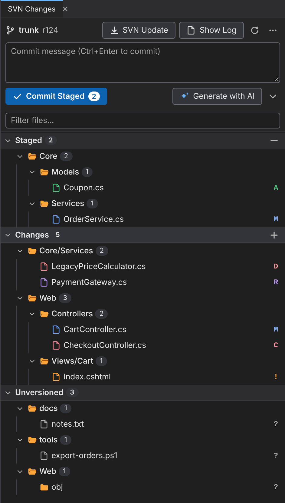

  *SVN Changes panel with two files in Staged, the modified files in the Changes section and the Unversioned files; the commit button shows "Commit Staged 2".*
- **Log as a document.** Show Log opens as a document in the Visual Studio editor area, with a table of revisions. Filters by author, text, path and dates. For each revision the changed files are listed. Ctrl+click on two revisions compares them. The command is also available for files and folders from Solution Explorer.

  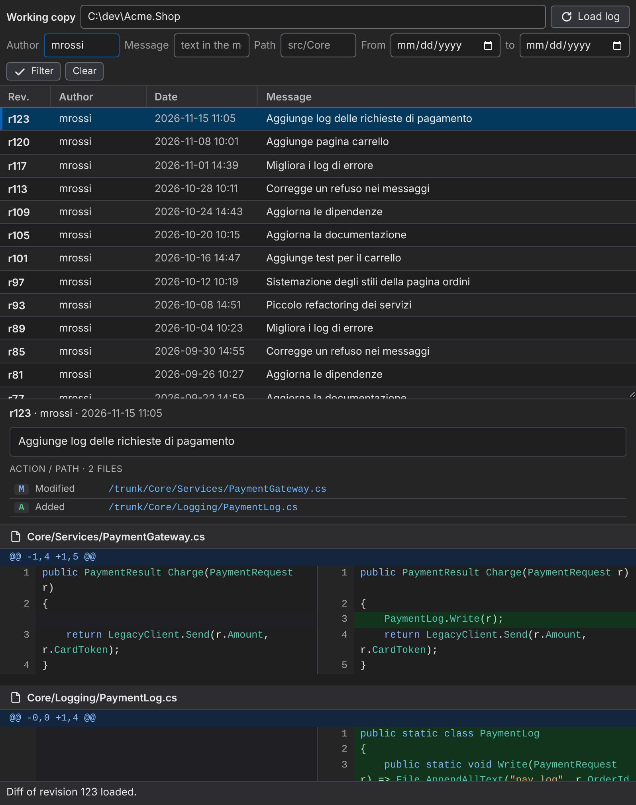

  *Log with the Author filter set to "mrossi", revision r123 selected, the changed files and the diff.*

  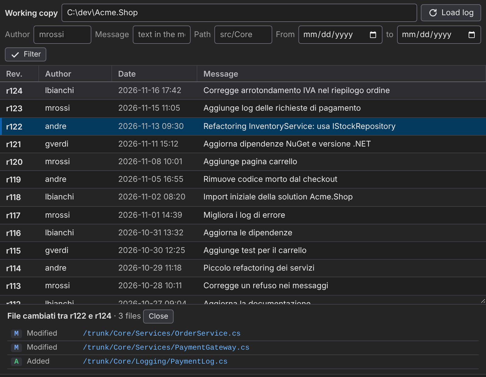

  *Log with r122 selected and Ctrl+click on r124: below the table the files changed between the two revisions are listed.*

  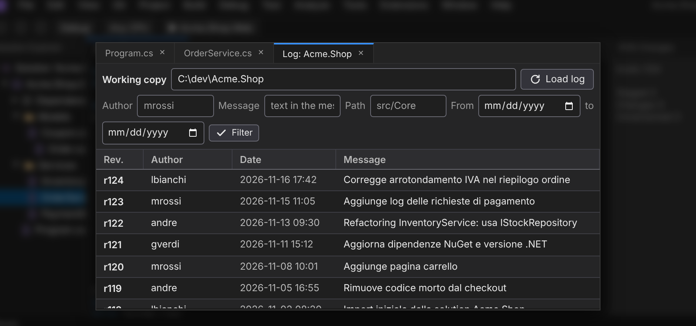

  *Illustration: the Log open as a document in the Visual Studio editor area, with the "Log: Acme.Shop" tab next to the open files. Reconstruction of the appearance, not a Visual Studio screenshot.*
- **Visual Studio diff.** Differences between the working copy, revisions and folders open in the Visual Studio viewer. TortoiseSVN is not required for the diff.

  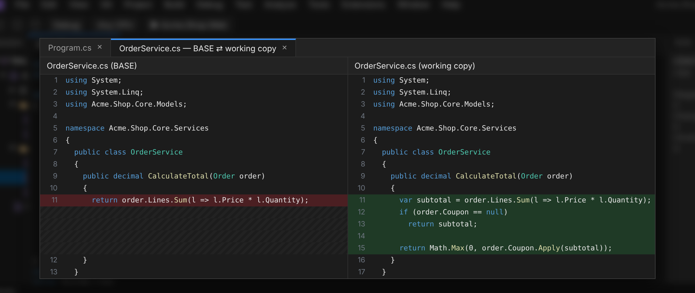

  *Illustration: diff of OrderService.cs in the Visual Studio viewer, with BASE on the left and the working copy on the right. Reconstruction of the appearance, not a Visual Studio screenshot.*
- **Update to revision, Cleanup, Lock / Unlock.**
  - "SVN Update to revision": choose the revision from a list.
  - "SVN Cleanup": Visual Studio menu command. If the working copy is locked, the Cleanup button also appears.
  - "Lock / Unlock": locks and unlocks files.

  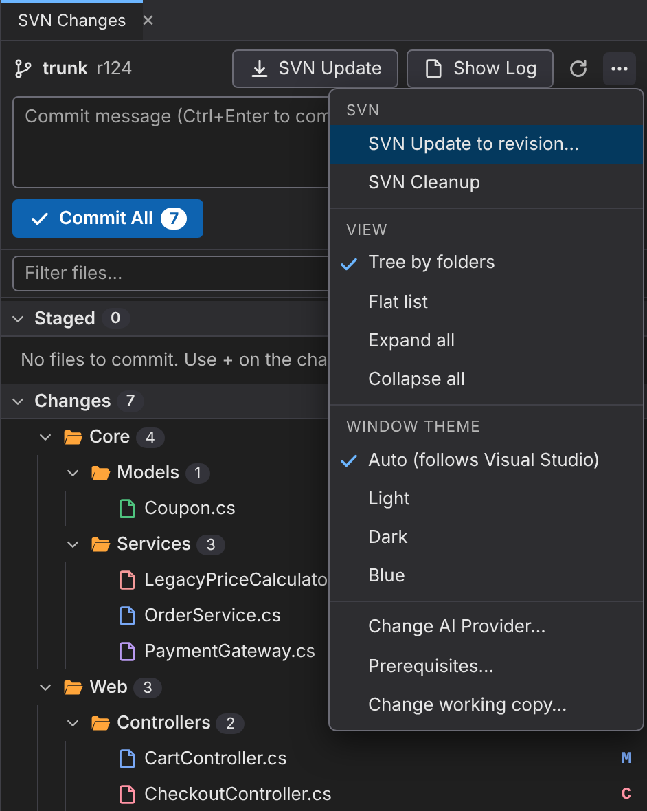

  *"..." menu of the SVN Changes panel with the entries SVN Update to revision..., SVN Cleanup, the view options, Window theme and Change AI Provider....*

  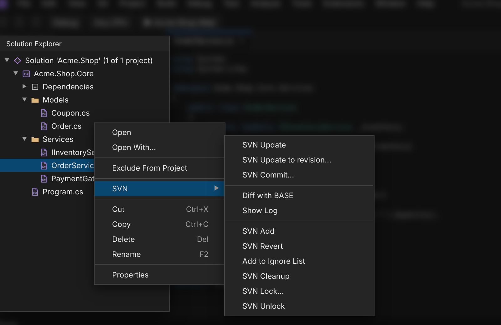

  *Illustration: right-click menu on a file in Solution Explorer, with the SVN submenu (SVN Update, SVN Update to revision..., SVN Commit..., Diff with BASE, Show Log, SVN Add, SVN Revert, Add to Ignore List, SVN Cleanup, SVN Lock..., SVN Unlock). Reconstruction of the appearance, not a Visual Studio screenshot.*
- **SVN login.** The password is asked only if the one saved in the Subversion cache is missing or expired. With Windows integrated authentication it is never asked. The cache is the same one used by TortoiseSVN.

  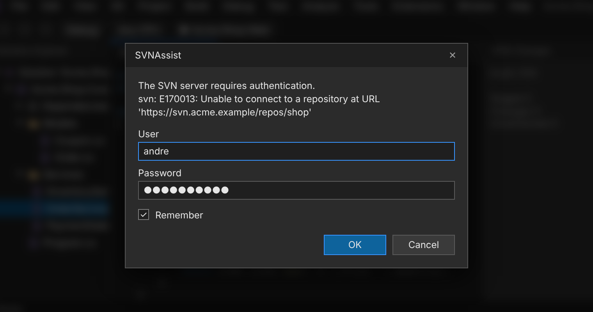

  *Illustration: SVN login popup with the User and Password fields and the Remember checkbox. Reconstruction of the appearance, not a Visual Studio screenshot.*
- **AI setup wizard.** Steps: choice of the service (GitHub Copilot, Claude Code, Claude API, GitHub Models), installation of missing prerequisites, sign-in, choice of the model. It reopens from Extensions > SVNAssist > "Change AI Provider...". Prerequisites are shown in green or red and are clickable. For GitHub Models the model used is openai/gpt-4o-mini.

  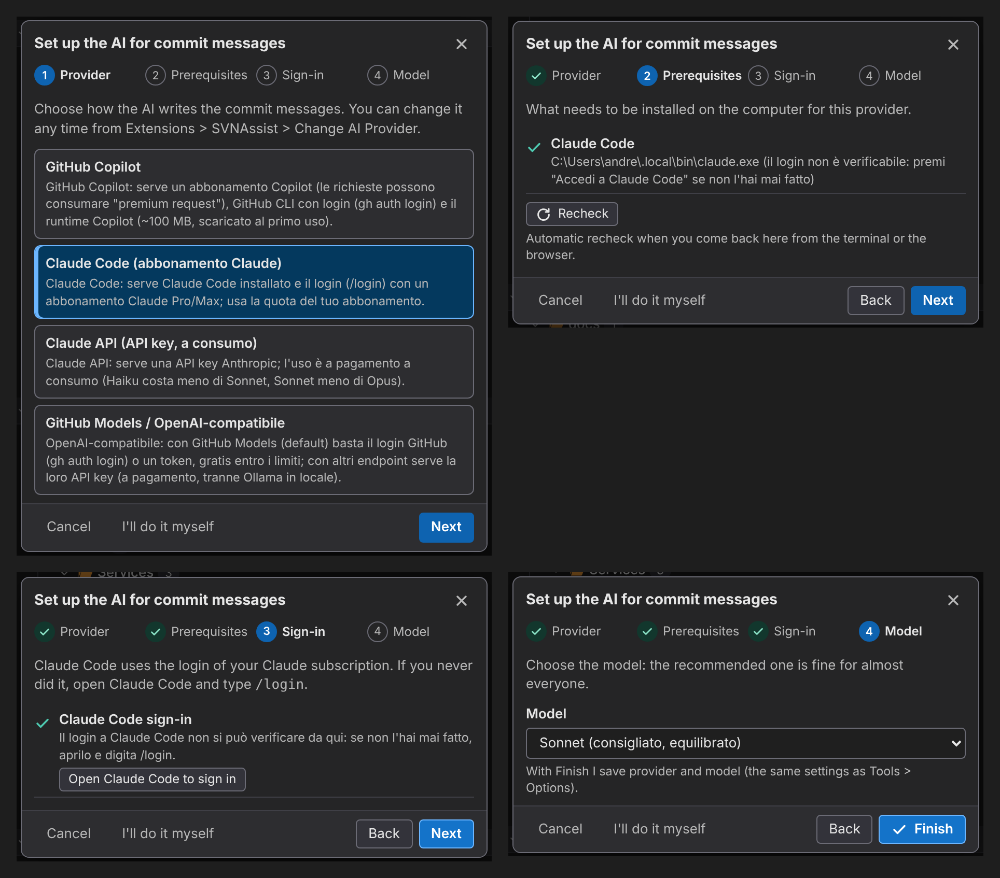

  *The four steps of the wizard: Provider, Prerequisites, Sign-in, Model. The texts of the provider cards are those of the interactive demo.*
- **Themes.** Light, Dark, Blue or High Contrast. The change applies without restarting Visual Studio.

  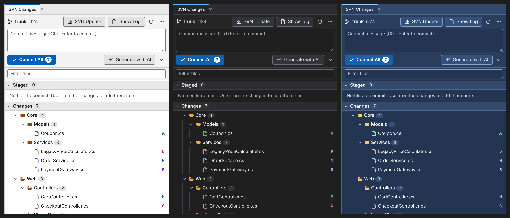

  *SVN Changes panel with the Light, Dark and Blue themes.*
- **Language.** Italian or English, from Extensions > SVNAssist > Language / Lingua or from Tools > Options. "Automatic" follows the Visual Studio language. The change applies without restarting Visual Studio and covers windows, service messages, dialogs and settings. SVN command names and svn program messages do not change. The language of AI-generated commit messages is a separate setting.

  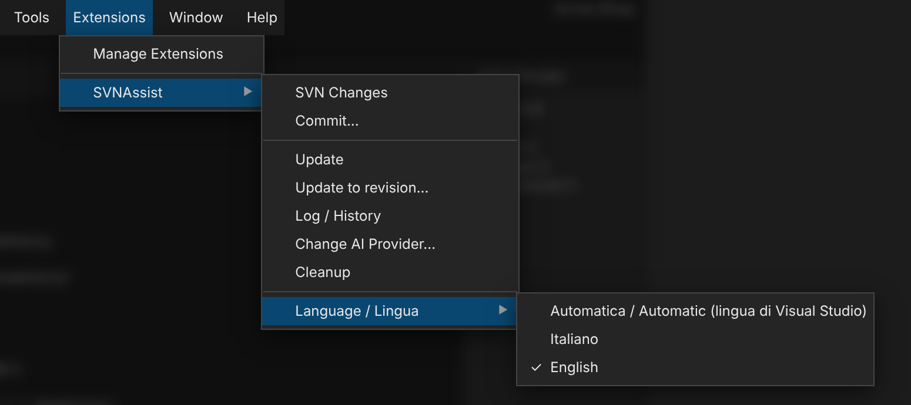

  *Illustration: Extensions > SVNAssist > Language / Lingua menu with the entries Automatic, Italiano and English. Reconstruction of the appearance, not a Visual Studio screenshot.*

## Changes

- **AI models from a drop-down menu.** The model is chosen from a drop-down (Claude, Copilot, GitHub Models). The default Claude model is Sonnet. Before: the default was Opus.
- **Prerequisites per provider.** The wizard shows only the prerequisites of the chosen service, with notes on sign-in, key and cost.
- **Saved model no longer in the list.** If the saved model no longer appears in the list, the default model is used.
- **Menu entries in English.** "Change AI Provider...", "Diff with BASE", "Show Log" and "Add to Ignore List" use standard SVN English.

## Fixes

- **Dark and Blue themes.** Before: black text on a black background. Now: the Changes and Log windows use the Visual Studio colors.
- **Generate with AI.**
  - Errors and cancellations. Before: "OK" was shown with no message. Now: the reason appears in the status bar.
  - Sign-in. Before: after the popup was closed once, nothing opened anymore. Now: the popup appears again at each attempt.
  - AI not configured. It suggests signing in from the terminal (with GitHub CLI or with Claude Code), or a token as an alternative.
  - Added, deleted, empty or binary files appear in the generated commit message.
  - With many modified files the generation works, because the diff is compacted.
  - Follows the commit rules defined in the project instructions for GitHub Copilot and in the personal ones for Copilot.
- **Select all.** Before: it also selected unversioned files in the build folders (bin, obj). Now: it selects only the Changes section.
- **Working Copy Path.** The path set in Working Copy Path takes precedence over automatic detection, including in the Log.
- **Operation already in progress.** Before: a second click did nothing. Now: it shows "Operation in progress...".
- **Right-click menu.** The entries update when the state of a file changes.

## Requirements and installation

- Visual Studio 2026 (18.x).
- Visual Studio 2022: declared, not yet tested.
- An SVN client on the PC that provides the svn command from the command line: SlikSVN, TortoiseSVN with the command line tools, or other.
- .NET 10 runtime. If it is missing, SVNAssist offers to install it, or opens the page from which it can be downloaded (.NET Runtime 10.x, Windows x64).
- GitHub Models with the GitHub CLI token: with error 401 or 403, create a token with the `models:read` permission.
- 0.1.0 is deprecated: uninstall it and install 0.2.0.

Installation:

1. Close Visual Studio.
2. Double-click the SVNAssist .vsix package to open it.
3. Restart Visual Studio.

The interactive demo is in a separate archive.
