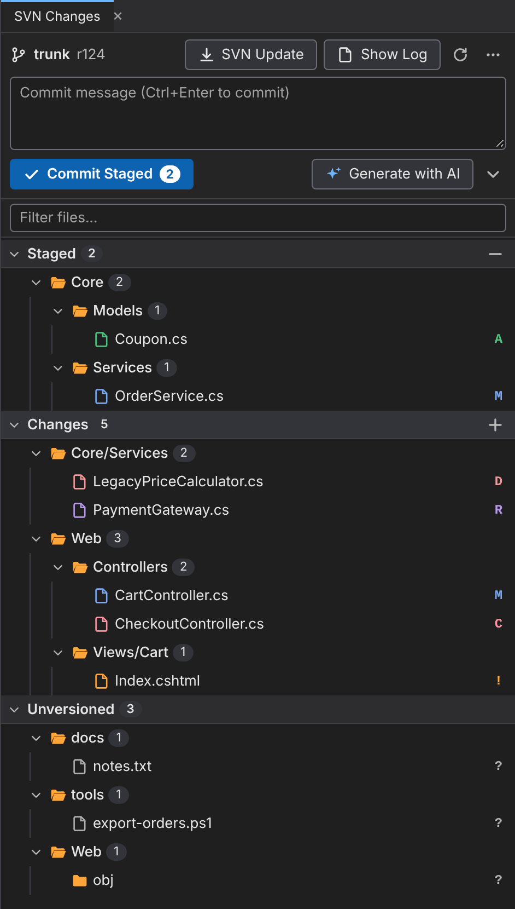
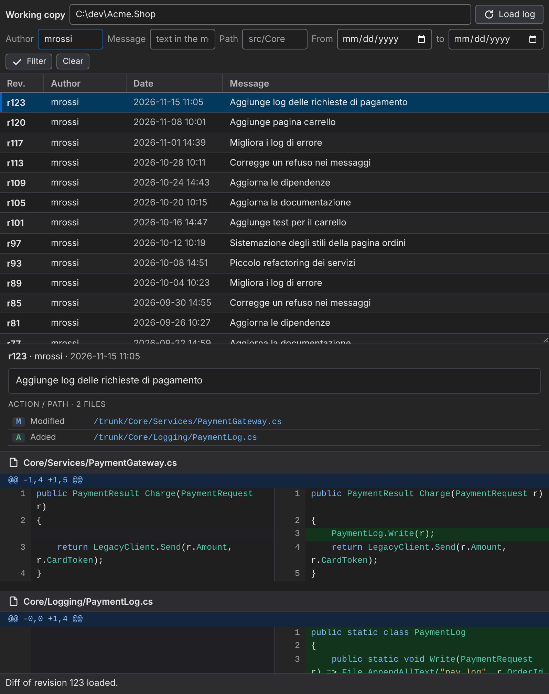
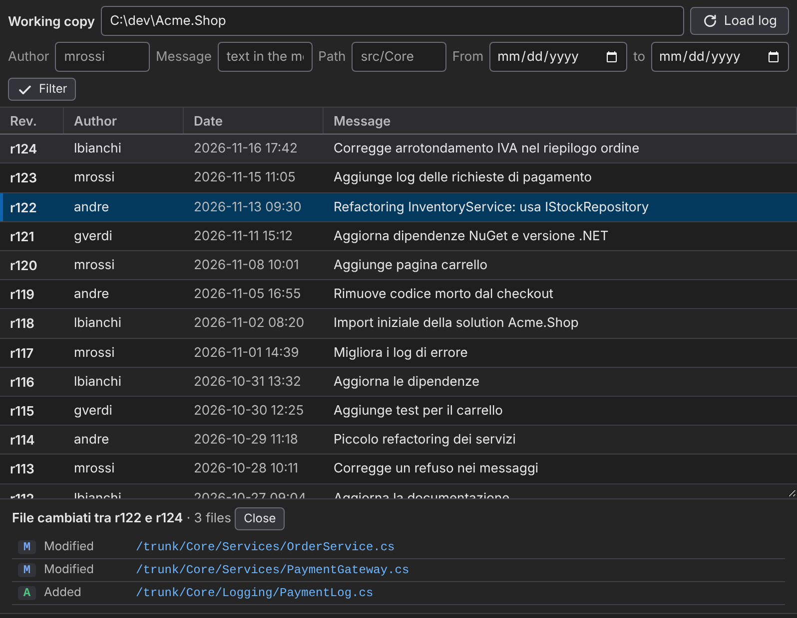
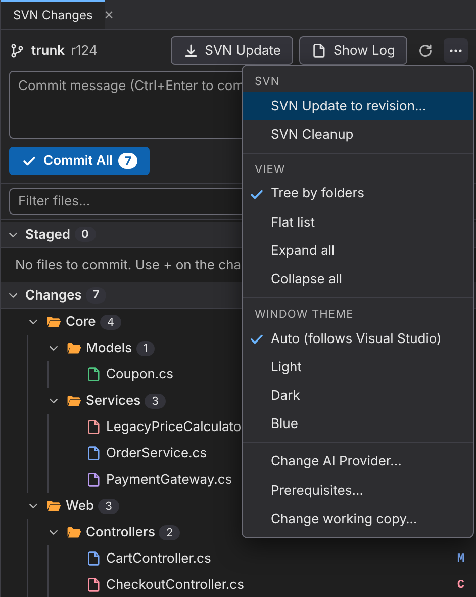
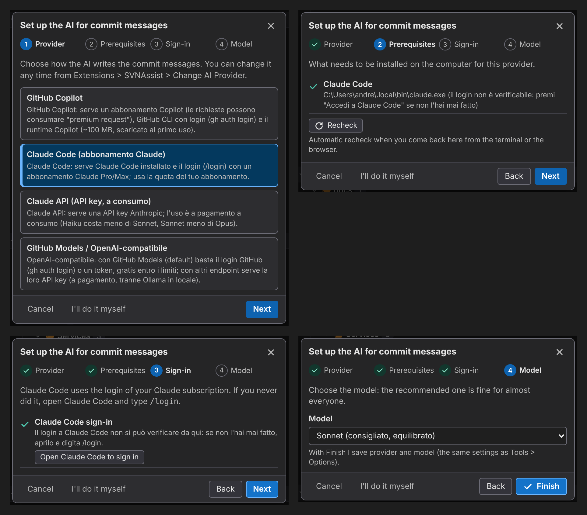
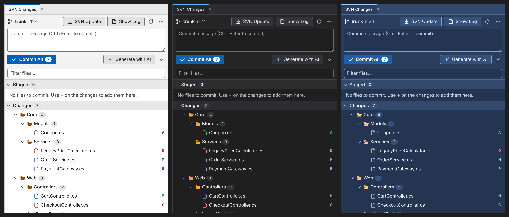

# SVNAssist 0.2.0

## Novità

- **Pannello SVN Changes in stile Git.** Mostra i file in un albero, con le sezioni Staged, Modifiche e Non versionati. Il pannello ha un filtro e si usa da tastiera (frecce, Spazio, Invio; Canc elimina con conferma). Il pulsante di commit è "Commit All" se Staged è vuoto, altrimenti "Commit Staged (n)", dove n è il numero di file in Staged. Ogni azione mostra un messaggio di stato.

  

  *Pannello SVN Changes con due file in Staged, i file modificati nella sezione Modifiche e i file Non versionati; il pulsante di commit mostra "Commit Staged 2".*
- **Log come documento.** Show Log si apre come documento nell'area editor di Visual Studio, con una tabella delle revisioni. Filtri per autore, testo, percorso e date. Per ogni revisione sono elencati i file cambiati. Ctrl+clic su due revisioni le confronta. Il comando è disponibile anche per file e cartelle da Esplora soluzioni.

  

  *Log con il filtro Author impostato su "mrossi", la revisione r123 selezionata, i file cambiati e il diff.*

  

  *Log con r122 selezionata e Ctrl+clic su r124: sotto la tabella sono elencati i file cambiati tra le due revisioni.*

  > [IMMAGINE DA FORNIRE: il Log aperto come documento nell'area editor di Visual Studio, con la scheda "SVN Log" accanto ai file aperti] (file: docs/release-notes/img/0.2.0/07-log-documento-vs.png)
- **Diff di Visual Studio.** Le differenze tra working copy, revisioni e cartelle si aprono nel visualizzatore di Visual Studio. Per il diff non è richiesto TortoiseSVN.

  > [IMMAGINE DA FORNIRE: un diff aperto nel visualizzatore nativo di Visual Studio (working copy contro BASE di un file modificato)] (file: docs/release-notes/img/0.2.0/08-diff-nativo-vs.png)
- **Update a revisione, Cleanup, Lock / Unlock.**
  - "SVN Update to revision": si sceglie la revisione da un elenco.
  - "SVN Cleanup": comando del menu di Visual Studio. Se la working copy risulta bloccata, compare anche il pulsante Cleanup.
  - "Lock / Unlock": blocca e sblocca i file.

  

  *Menu "..." del pannello SVN Changes con le voci SVN Update to revision..., SVN Cleanup, le opzioni di vista, Window theme e Change AI Provider....*

  > [IMMAGINE DA FORNIRE: il menu SVN del tasto destro in Esplora soluzioni su un file o una cartella (Update, Diff, Log, Lock, Unlock)] (file: docs/release-notes/img/0.2.0/09-menu-esplora-soluzioni.png)
- **Login SVN.** La password viene chiesta solo se quella salvata nella cache di Subversion manca o è scaduta. Con l'autenticazione integrata di Windows non viene mai chiesta. La cache è la stessa usata da TortoiseSVN.

  > [IMMAGINE DA FORNIRE: il popup di login SVN che chiede nome utente e password quando la password salvata nella cache di Subversion manca o è scaduta] (file: docs/release-notes/img/0.2.0/10-login-svn.png)
- **Procedura guidata per l'AI.** Passi: scelta del servizio (GitHub Copilot, Claude Code, Claude API, GitHub Models), installazione dei prerequisiti mancanti, login, scelta del modello. Si riapre da Extensions > SVNAssist > "Change AI Provider...". I prerequisiti sono indicati in verde o in rosso e sono cliccabili. Per GitHub Models il modello usato è openai/gpt-4o-mini.

  

  *I quattro passi della procedura guidata: Provider, Prerequisites, Sign-in, Model. I testi delle schede provider sono quelli della demo interattiva.*
- **Temi.** Chiaro, scuro, blu o alto contrasto. Il cambio si applica senza riavviare Visual Studio.

  

  *Pannello SVN Changes con i temi Light, Dark e Blue.*
- **Lingua.** Italiano o English, da Extensions > SVNAssist > Language / Lingua oppure da Tools > Options. "Automatica" segue la lingua di Visual Studio. Il cambio si applica senza riavviare Visual Studio e riguarda finestre, messaggi del servizio, dialoghi e impostazioni. I nomi dei comandi SVN e i messaggi del programma svn non cambiano. La lingua dei messaggi di commit generati con AI è un'impostazione separata.

  > [IMMAGINE DA FORNIRE: il menu Extensions > SVNAssist > Language / Lingua con le voci Automatica, Italiano, English] (file: docs/release-notes/img/0.2.0/11-lingua-menu.png)

## Modifiche

- **Modelli AI da menu a tendina.** Il modello si sceglie da un menu a tendina (Claude, Copilot, GitHub Models). Il modello predefinito di Claude è Sonnet. Prima il predefinito era Opus.
- **Prerequisiti per provider.** Nella procedura guidata sono mostrati solo i prerequisiti del servizio scelto, con note su login, chiave e costo.
- **Modello salvato non più in elenco.** Se il modello salvato non compare più nell'elenco, si usa il modello predefinito.
- **Voci di menu in inglese.** "Change AI Provider...", "Diff with BASE", "Show Log" e "Add to Ignore List" sono in inglese standard di SVN.

## Correzioni

- **Temi scuro e blu.** Prima: testo nero su sfondo nero. Ora: le finestre Changes e Log usano i colori di Visual Studio.
- **Genera con AI.**
  - Errori e annullamenti: prima venivano mostrati "OK" senza messaggio. Ora il motivo compare nella barra di stato.
  - Login: prima, dopo la chiusura del popup una volta, non si apriva più nulla. Ora il popup ricompare a ogni tentativo.
  - AI non configurata: propone il login dal terminale (con GitHub CLI o con Claude Code), in alternativa un token.
  - File aggiunti, eliminati, vuoti o binari compaiono nel messaggio di commit generato.
  - Con molti file modificati la generazione funziona, perché il diff viene compattato.
  - Segue le regole di commit definite nelle istruzioni del progetto per GitHub Copilot e in quelle personali per Copilot.
- **Seleziona tutto.** Prima selezionava anche i file non versionati delle cartelle di build (bin, obj). Ora seleziona solo la sezione Modifiche.
- **Working Copy Path.** Il percorso impostato in Working Copy Path ha la precedenza sul rilevamento automatico, anche nel Log.
- **Operazione già in corso.** Prima un secondo clic non faceva nulla. Ora mostra "Operazione in corso…".
- **Menu del tasto destro.** Le voci si aggiornano quando cambia lo stato di un file.

## Requisiti e installazione

- Visual Studio 2026 (18.x).
- Visual Studio 2022: dichiarata, non ancora provata (da verificare).
- Un client SVN sul PC che fornisca il comando svn da riga di comando: SlikSVN, TortoiseSVN con gli strumenti da riga di comando, o altro.
- Runtime .NET 10. Se manca, SVNAssist propone di installarlo, oppure apre la pagina da cui scaricarlo (.NET Runtime 10.x, Windows x64).
- GitHub Models con il token di GitHub CLI: con errore 401 o 403, creare un token con il permesso `models:read`.
- Sostituisce la 0.1.0: disinstallare la 0.1.0 prima di installare questa versione.

Installazione:

1. Chiudere Visual Studio.
2. Aprire con doppio clic il pacchetto .vsix di SVNAssist.
3. Riavviare Visual Studio.

La demo interattiva è in un archivio separato.

Dettagli tecnici

**Installazione**

- Chiudere Visual Studio, doppio clic su SVNAssist.vsix, riavvio. Runtime .NET 10 controllato all'avvio del backend; installazione automatica con winget, con fallback allo script ufficiale.
- Requisiti: Visual Studio 2026 (18.x; la 2022 è dichiarata ma non ancora provata); svn.exe (SlikSVN, TortoiseSVN con command line tools o altro); .NET 10 Runtime (se manca, SVNAssist propone di installarlo o apre la pagina giusta: ".NET Runtime 10.x – Windows x64 installer").
- La 0.1.0 è sostituita da questa versione: disinstallarla prima.

**Architettura e funzioni**

- Nuova architettura: finestre in WebView2 con il design della demo; logica SVN e AI in un servizio .NET 10 separato (se cade, Visual Studio resta aperto).
- Changes: albero con Staged / Modifiche / Non versionati; Commit All se Staged è vuoto, Commit Staged (n) altrimenti; Canc elimina con conferma.
- Log come documento nell'area editor; filtri autore/testo/percorso/date; confronto tra revisioni con Ctrl+clic; vale anche per file e cartelle da Esplora soluzioni.
- Diff nativo di VS ovunque (working copy, revisioni, cartelle).
- SVN Update to revision con elenco revisioni; SVN Cleanup (anche come pulsante se la working copy è bloccata); Lock / Unlock.
- Login SVN solo se le credenziali in cache mancano o scadono (cache standard di Subversion, condivisa con TortoiseSVN); con accesso integrato Windows non compare mai.
- Procedura guidata AI (provider, prerequisiti, accesso, modello); prerequisiti verdi/rossi cliccabili; prerequisiti filtrati per provider, con nota su login, chiave e costo.
- Modelli da tendina, default Claude Sonnet (era Opus, più costoso); GitHub Models usa openai/gpt-4o-mini. Un modello salvato che non è più in elenco torna al default.
- Temi chiaro / scuro / blu / alto contrasto con cambio a caldo; lingua Italiano / English a caldo (Automatica segue Visual Studio). Lingua: Extensions > SVNAssist > Language / Lingua (Automatica = lingua di Visual Studio, Italiano, English) o Tools > Options. Cambia a caldo finestre, messaggi del servizio, dialoghi e impostazioni, senza riavviare VS. I nomi dei comandi SVN e i messaggi di svn.exe restano invariati; la lingua dei commit message AI è un'impostazione separata. Alcune voci di menu di VS sono ora in inglese standard SVN ("Change AI Provider...", "Diff with BASE", "Show Log", "Add to Ignore List").

**Correzioni**

- Tema scuro/blu: niente più testo nero su nero; finestre Changes e Log usano i colori di Visual Studio.
- Genera con AI: se l'AI non è configurata propone il login nel terminale (`gh auth login --web` o `claude`), in alternativa il token; il popup si ripresenta a ogni click (prima, chiuso una volta, non si apriva più nulla); ogni errore o annullamento è mostrato nella barra di stato (prima: "OK" e nessun messaggio); i file aggiunti, eliminati, vuoti o binari compaiono nel messaggio; con molti file modificati funziona comunque (diff compattato); segue le regole di commit in `.github/copilot-instructions.md`, `.github/instructions/*.instructions.md` e `~/.copilot/copilot-instructions.md`.
- "Seleziona tutto" spunta solo la sezione Modifiche (non più bin/obj non versionati).
- Il setting Working Copy Path, se impostato, vince sul rilevamento automatico (anche nel Log).
- Se un'operazione è già in corso, un nuovo click mostra "Operazione in corso…" invece di non fare nulla.
- Voci dei menu contestuali aggiornate quando lo stato di un file cambia.

**Note di aggiornamento**

- Un modello salvato che non è più in elenco torna al default.
- GitHub Models con il token di GitHub CLI: se ricevi 401/403, crea un token con permesso `models:read`.
- Release automatiche da GitHub Actions.
- Demo: archivio separato `svnassist-demo`.

