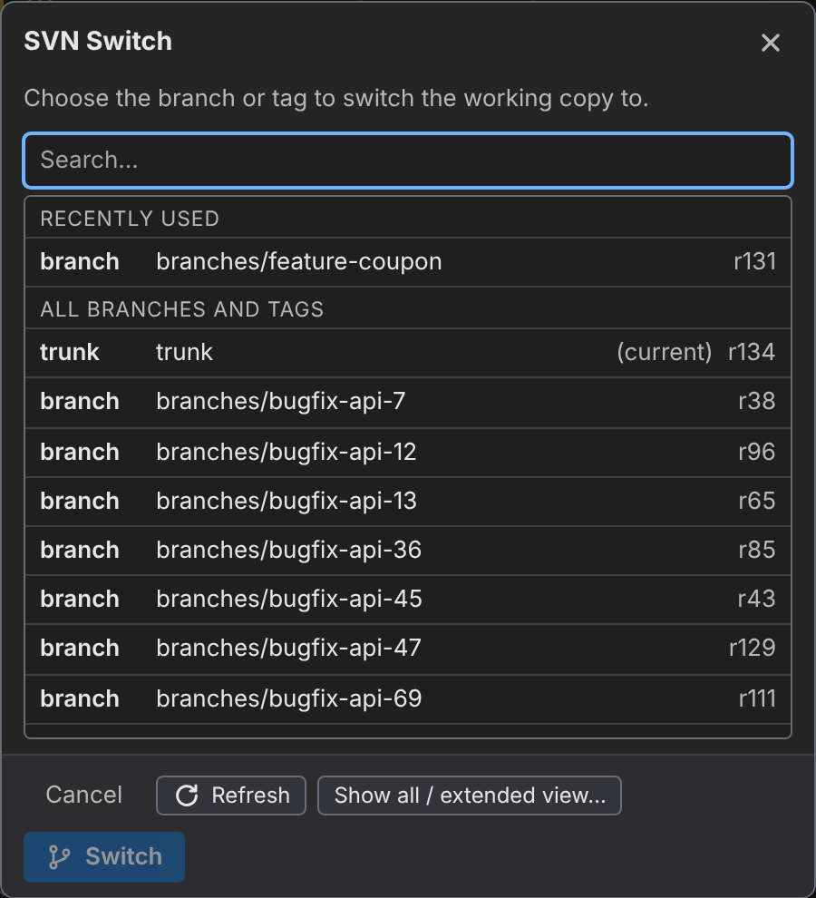
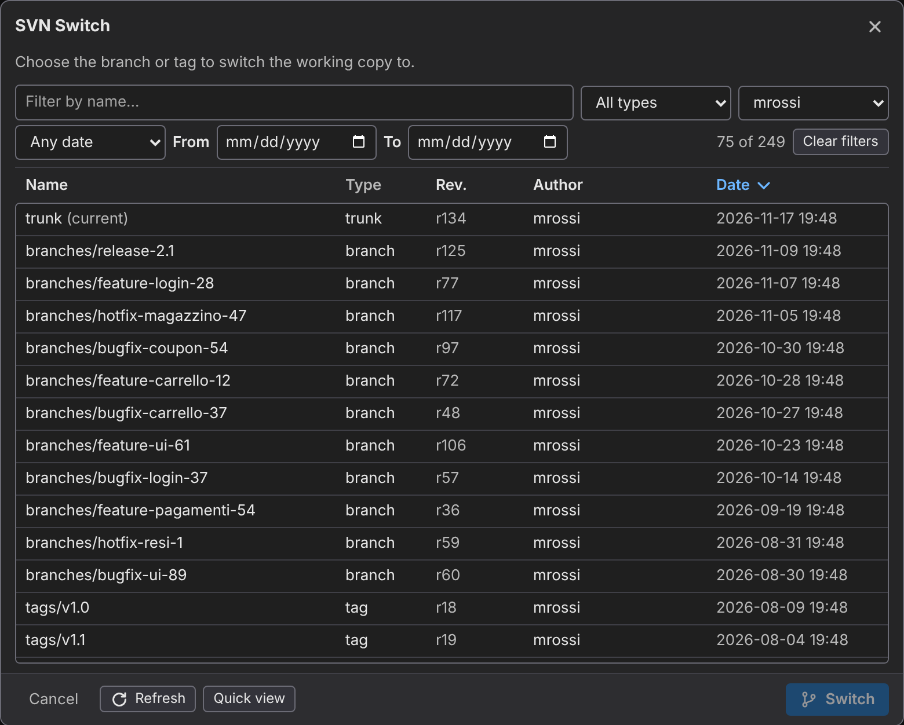
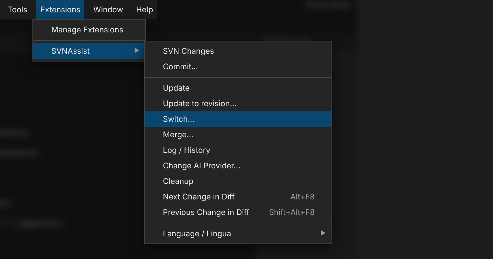
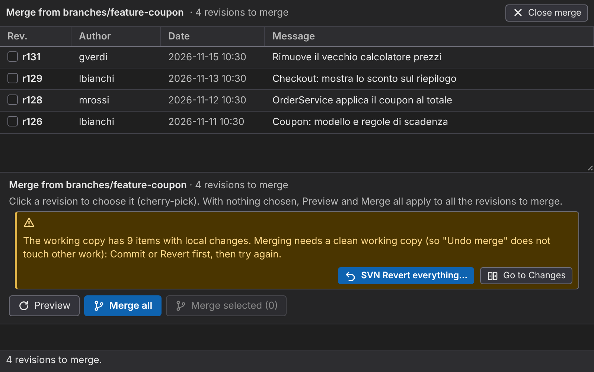
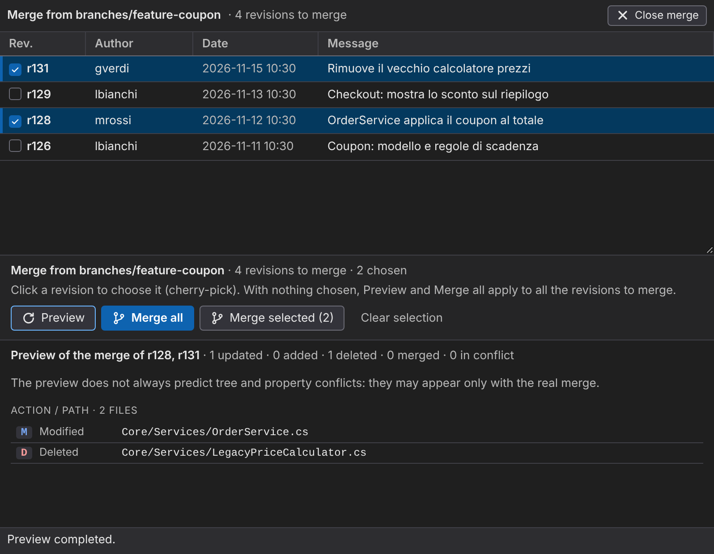
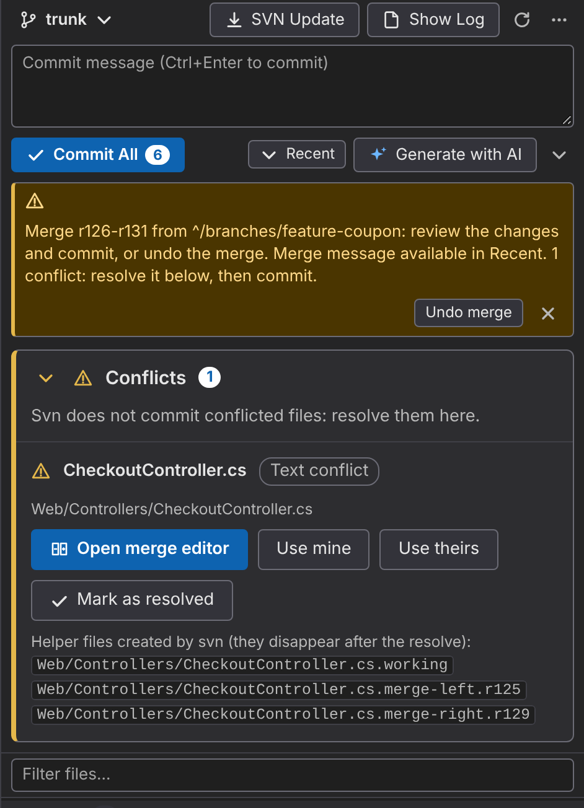
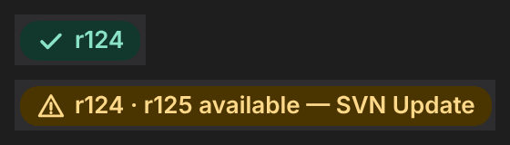
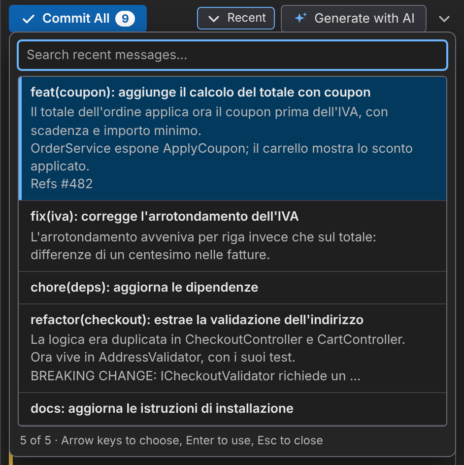

# SVNAssist 0.3.0

Release date: 2026-11-12.

## New

- **Switch.** The current branch is always visible in SVN Changes. **Switch...** opens from Changes or from Extensions > SVNAssist.
  - The selector shows the recently used items and has a search.
  - The extended view, for repositories with hundreds of branches and tags, has filters by name, type, author and period, and sorting by name, date, revision or author.
  - The repository layout (trunk/branches/tags) can be configured, including with the project at the root or in a subfolder.

  

  *SVN Switch: the selector with the search, the "Recently used" group (feature-coupon) and the list of branches and tags.*

  

  *Extended view of the selector, with the author filter set to "mrossi" and sorting by date; the counter shows 75 items out of 249.*

   SVNAssist menu">

  *Illustration: the Extensions > SVNAssist menu with the Switch... and Merge... entries, Next Change in Diff and Previous Change in Diff. A reconstruction of the appearance, not a screenshot of Visual Studio.*
- **SVN Merge...** Choose the branch. The Log opens as a document with only the revisions to merge.
  - **Preview** runs a simulation without modifying files.
  - **Merge all** and **Merge selected** (cherry-pick).
  - If the working copy has changes or mixed revisions, a message explains it and offers **SVN Revert everything…** and **SVN Update now**.
  - **Undo merge** from the banner, with confirmation and a list of files.
  - The message in the style of TortoiseSVN ("Merged revision(s) 8-10 from …") is saved in Recent.

  

  *Merge from branches/feature-coupon with the working copy having 9 modified items: the message explains that a clean working copy is needed and offers SVN Revert everything... and Go to Changes.*

  

  *Revisions to merge with r128 and r131 selected and the result of Preview: one file updated, one deleted, no conflicts.*

  

  *After Merge all: the banner with Undo merge and the Conflicts panel with the file CheckoutController.cs and the actions Open merge editor, Use mine, Use theirs, Mark as resolved.*
- **Conflicts.** The Conflicts panel in SVN Changes offers for each file: **Open merge editor** (Visual Studio 3-way editor), **Use mine**, **Use theirs**, **Mark as resolved**.
  - Tree conflicts are grouped, with **Mark all as resolved**.
  - The auxiliary files created by svn are placed under the conflicted file and not among the unversioned files.
- **Cancel individual lines.** A Cancel button next to each diff block, or right-click > **SVN: Revert Selected Changes** on a selection. The button has not been verified in all Visual Studio diff views.
- **Next / previous change in the diff.** Alt+F8 and Shift+Alt+F8. The shortcuts can be changed in the options.
- **Revision indicator.** At the bottom of SVN Changes: green if the working copy is at the latest revision; orange, with "rN available — SVN Update", if others have committed. The check is read-only and runs every 5 minutes; the interval can be changed or disabled in Tools > Options.

  

  *Revision indicator at the bottom of SVN Changes: green with "r124" when the working copy is up to date; orange with "r124 · r125 available — SVN Update" when a colleague has committed.*
- **Recent.** Panel with search and preview of the last 25 commit messages per repository.

  

  *Recent panel with the search field and the preview of the commit messages.*
- **Revert everything per section.** Right-click on Changes or on Staged offers **SVN Revert everything…**, with confirmation.
- **Generate with AI on all changes.** Large diffs are split into blocks, summarized and combined into a single message (title and a list by area), also with hundreds of files. The message follows the project's commit rules and the global ones, for example Conventional Commits.

## Changes

- The Log always opens in the document area, next to the diffs.
- Double-clicking an added or unversioned file opens the whole file.
- Result messages disappear after a few seconds; errors stay.
- The SVN submenu in Solution Explorer has been removed, because the actions are available in SVN Changes.

## Fixes

- **Generate with AI, Copilot.** Before: error "No response was returned". Now: a new attempt with a smaller request and an error message.
- **Generate with AI, OpenAI-compatible providers.** Before: error "'0' is an invalid start of a value". Now: a new attempt with a smaller request and an error message.
- **Generate with AI, format.** Before: the generated message was wrapped in a code block. Now: the code block is not added.
- **Windows restored at startup.** Before: a SVNAssist window restored by Visual Studio could show the error "Failed to find the tool window". Now: if the window cannot be created, the reason appears in the window itself.

Known limitations:

- Create branch/tag and a guided merge wizard are not present.
- On very slow repositories Switch and Merge have no progress indicator.

## Requirements and installation

- Visual Studio 2026 (18.x).
- Visual Studio 2022: declared, not yet tested.
- svn client 1.8 or later (SlikSVN, TortoiseSVN with the command line tools, or other).
- .NET 10 runtime. If it is missing, SVNAssist offers to install it.

Installation: same as 0.2.0. If 0.2.0 is installed, it is updated.
