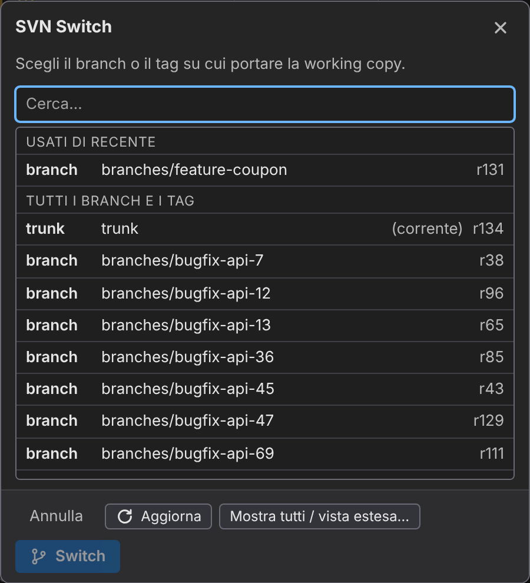
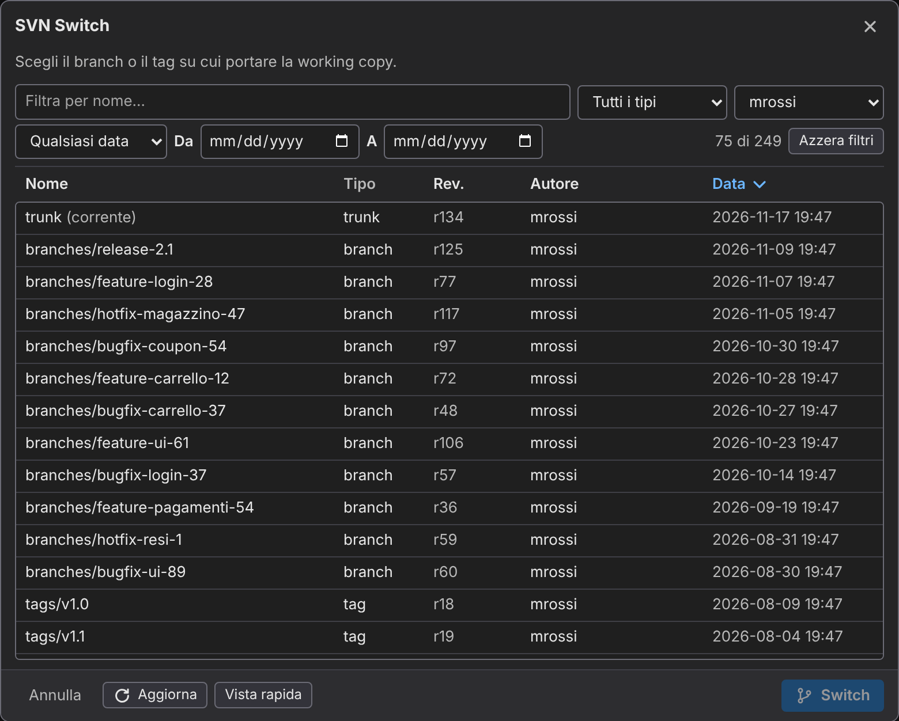
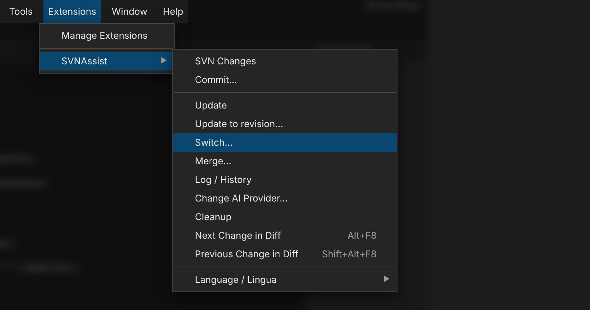
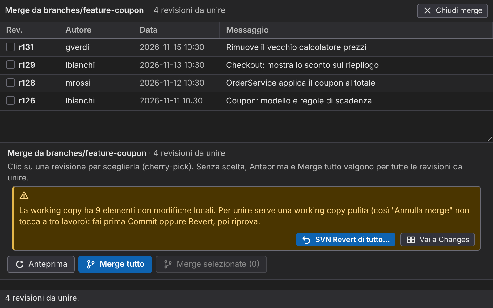
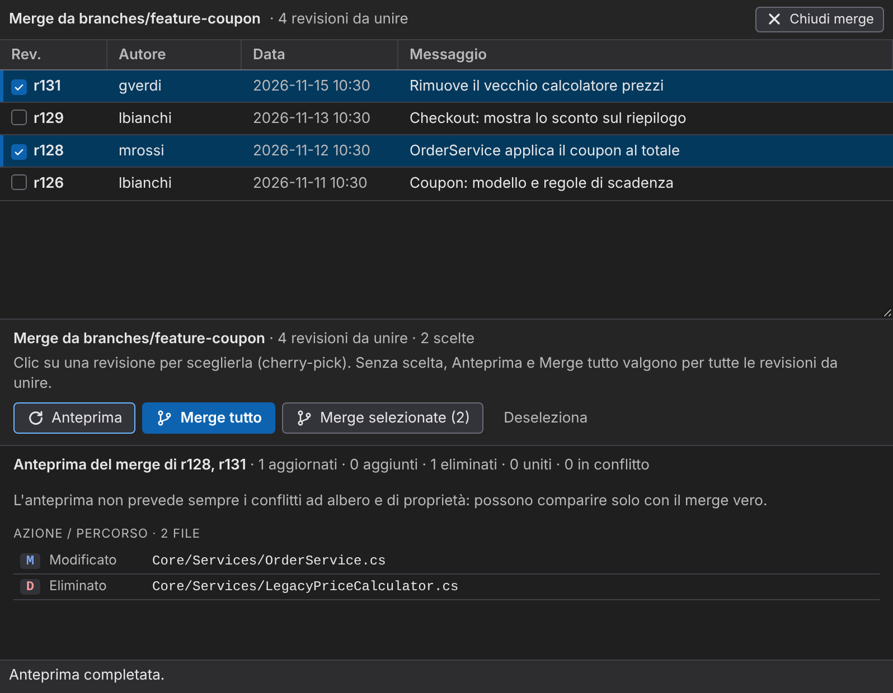
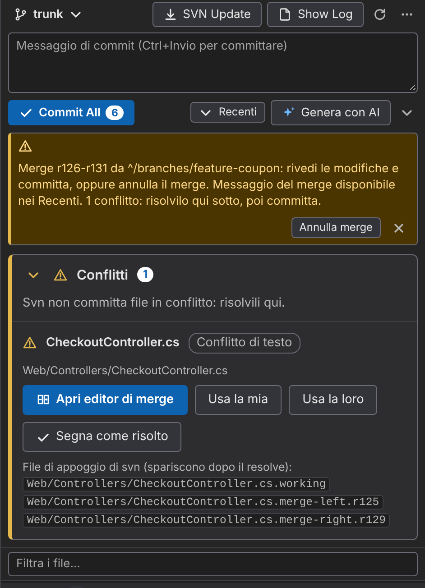
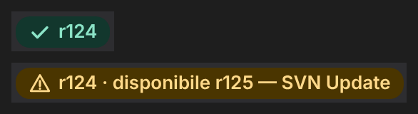
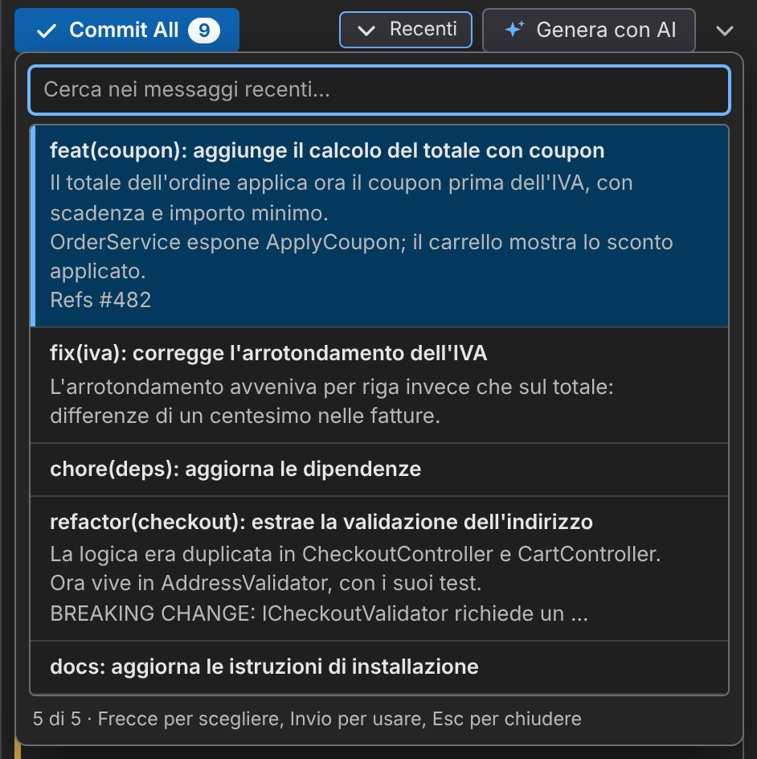

# SVNAssist 0.3.0

Data di rilascio: 2026-11-12.

## Novità

- **Switch.** Il ramo corrente è sempre visibile in SVN Changes. **Switch...** si apre da Changes o da Extensions > SVNAssist.
  - Il selettore mostra gli ultimi usati e ha la ricerca.
  - La vista estesa, per repository con centinaia di branch e tag, ha filtri per nome, tipo, autore e periodo e l'ordinamento per nome, data, revisione o autore.
  - Il layout del repository (trunk/branches/tags) è configurabile, anche con il progetto alla radice o in una sottocartella.

  

  *SVN Switch: il selettore con la ricerca, il gruppo "Usati di recente" (feature-coupon) e l'elenco di branch e tag.*

  

  *Vista estesa del selettore, con il filtro per autore impostato su "mrossi" e l'ordinamento per data; il contatore indica 75 voci su 249.*

   SVNAssist">

  *Illustrazione: menu Extensions > SVNAssist con le voci Switch... e Merge..., Next Change in Diff e Previous Change in Diff. Ricostruzione dell'aspetto, non uno screenshot di Visual Studio.*
- **SVN Merge...** Si sceglie il branch e il Log si apre come documento con le sole revisioni da unire.
  - **Anteprima** esegue una simulazione senza modificare i file.
  - **Merge tutto** e **Merge selezionate** (cherry-pick).
  - Se la working copy ha modifiche o revisioni miste, un messaggio lo spiega e offre **SVN Revert di tutto…** e **SVN Update ora**.
  - **Annulla merge** dal banner, con conferma ed elenco dei file.
  - Il messaggio nello stile di TortoiseSVN ("Merged revision(s) 8-10 from …") viene salvato nei Recenti.

  

  *Merge da branches/feature-coupon con la working copy che ha 9 elementi modificati: il messaggio spiega che serve una working copy pulita e offre SVN Revert di tutto… e Vai a Changes.*

  

  *Revisioni da unire con r128 e r131 selezionate e il risultato di Anteprima: un file aggiornato, uno eliminato, nessun conflitto.*

  

  *Dopo Merge tutto: il banner con Annulla merge e il riquadro Conflitti con il file CheckoutController.cs e le azioni Apri editor di merge, Usa la mia, Usa la loro, Segna come risolto.*
- **Conflitti.** Il riquadro Conflitti in SVN Changes offre per ogni file: **Apri editor di merge** (editor a 3 vie di Visual Studio), **Usa la mia**, **Usa la loro**, **Segna come risolto**.
  - I conflitti ad albero sono raggruppati, con **Segna tutti come risolti**.
  - I file di appoggio creati da svn stanno sotto il file in conflitto e non tra i non versionati.
- **Annulla le singole righe.** Un pulsante Annulla accanto a ogni blocco del diff, oppure tasto destro > **SVN: Revert Selected Changes** su una selezione. Il pulsante non è stato verificato in tutte le viste diff di Visual Studio (da verificare).
- **Modifica successiva / precedente nel diff.** Alt+F8 e Shift+Alt+F8. Le scorciatoie si cambiano nelle opzioni.
- **Indicatore della revisione.** In basso in SVN Changes: verde se la working copy è all'ultima revisione; arancione, con "disponibile rN — SVN Update", se altri hanno committato. Il controllo è di sola lettura, ogni 5 minuti; l'intervallo si cambia o si disattiva in Tools > Options.

  

  *Indicatore della revisione in basso in SVN Changes: verde con "r124" quando la working copy è aggiornata; arancione con "r124 · disponibile r125 — SVN Update" quando un collega ha committato.*
- **Recenti.** Pannello con ricerca e anteprima degli ultimi 25 messaggi di commit per repository.

  

  *Pannello Recenti con il campo di ricerca e l'anteprima dei messaggi di commit.*
- **Revert di tutto per sezione.** Il tasto destro su Changes o su Staged offre **SVN Revert di tutto…**, con conferma.
- **Genera con AI su tutte le modifiche.** I diff grandi vengono divisi in blocchi, riassunti e ricomposti in un unico messaggio (titolo e elenco per area), anche con centinaia di file. Il messaggio segue le regole di commit del progetto e quelle globali, per esempio Conventional Commits.

## Modifiche

- Il Log si apre sempre nell'area documenti, accanto ai diff.
- Il doppio clic su un file aggiunto o non versionato apre il file intero.
- I messaggi di esito scompaiono dopo qualche secondo; gli errori restano.
- Il sottomenu SVN di Esplora soluzioni è stato rimosso, perché le azioni sono disponibili in SVN Changes.

## Correzioni

- **Genera con AI, Copilot.** Prima: errore "No response was returned". Ora: nuovo tentativo con una richiesta più piccola e messaggio di errore.
- **Genera con AI, provider compatibili con OpenAI.** Prima: errore "'0' is an invalid start of a value". Ora: nuovo tentativo con una richiesta più piccola e messaggio di errore.
- **Genera con AI, formato.** Prima: il messaggio generato era racchiuso in un blocco di codice. Ora: il blocco non viene aggiunto.
- **Finestre ripristinate all'avvio.** Prima: una finestra di SVNAssist ripristinata da Visual Studio poteva dare l'errore "Failed to find the tool window". Ora: se la finestra non si crea, il motivo compare nella finestra stessa.

Limiti noti:

- Crea branch/tag e una procedura guidata per il merge non sono presenti.
- Su repository molto lenti Switch e Merge non hanno l'avanzamento.

## Requisiti e installazione

- Visual Studio 2026 (18.x).
- Visual Studio 2022: dichiarata, non ancora provata (da verificare).
- Client svn 1.8 o successivo (SlikSVN, TortoiseSVN con gli strumenti da riga di comando, o altro).
- Runtime .NET 10. Se manca, SVNAssist propone di installarlo.

Installazione: come la 0.2.0. Se è installata la 0.2.0, viene aggiornata.

Dettagli tecnici

Testo tecnico originale: `docs/release-notes/v0.3.0.md`. Testo pubblicato in precedenza sulla Release: `docs/release-notes/archive/v0.3.0.github.md`.

- File di istruzioni di commit letti da Genera con AI: `.github/copilot-instructions.md`, `.github/instructions/*.instructions.md`, `CLAUDE.md`, `AGENTS.md`, `~/.copilot/copilot-instructions.md`, `~/.claude/CLAUDE.md`.
- File di appoggio di svn spostati sotto il file in conflitto: `.mine`, `.rNNN`, `.merge-left/right`, `.working`.
- Errore OpenAI-compatible corretto: "'0' is an invalid start of a value".
- Script `tools/setup-sim.ps1`: crea un repository di prova (storico, 150 branch, conflitti) per provare le funzioni in locale.
- Layout del repository: `trunk/branches/tags`.
- Il pulsante Annulla nel diff è nuovo e non è stato visto in tutte le viste diff; in alternativa, tasto destro > SVN: Revert Selected Changes.

