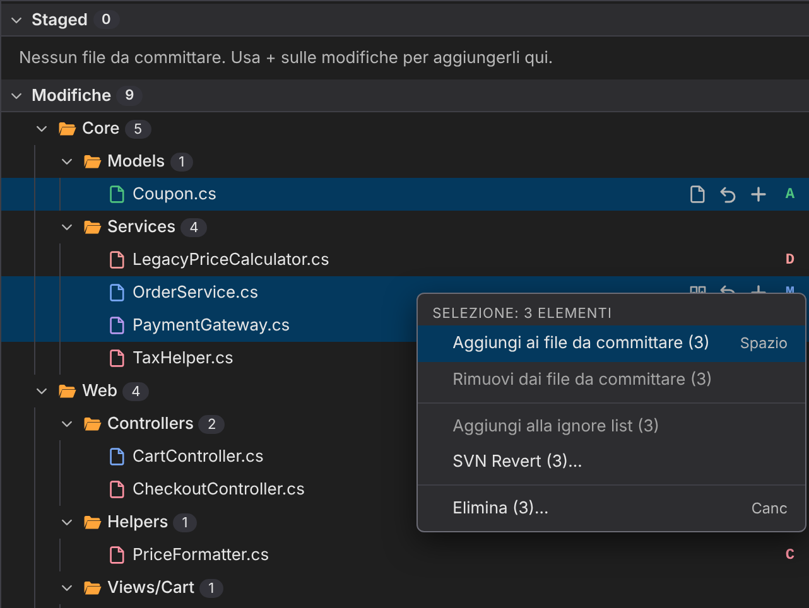
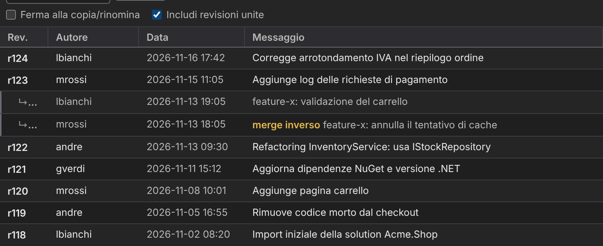
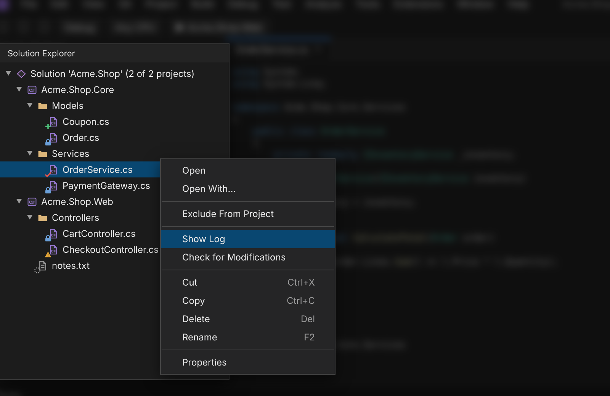
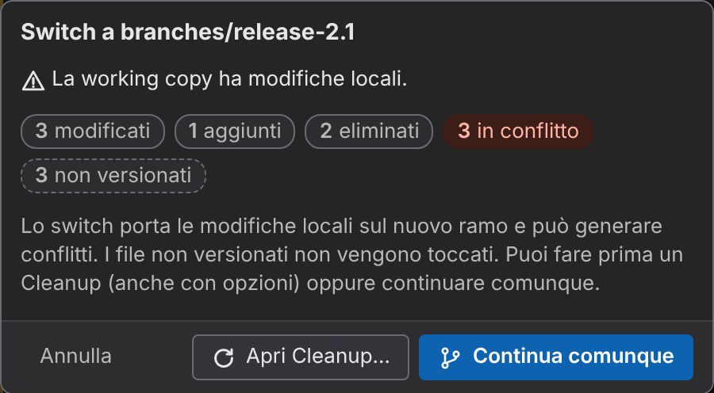
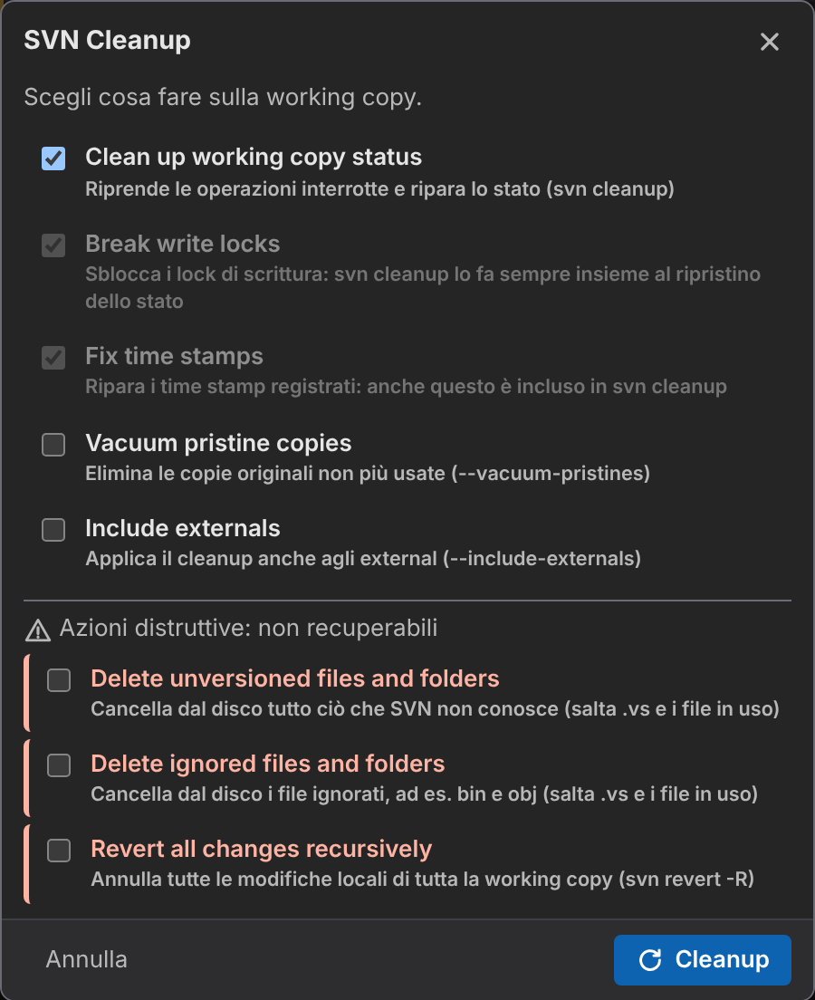
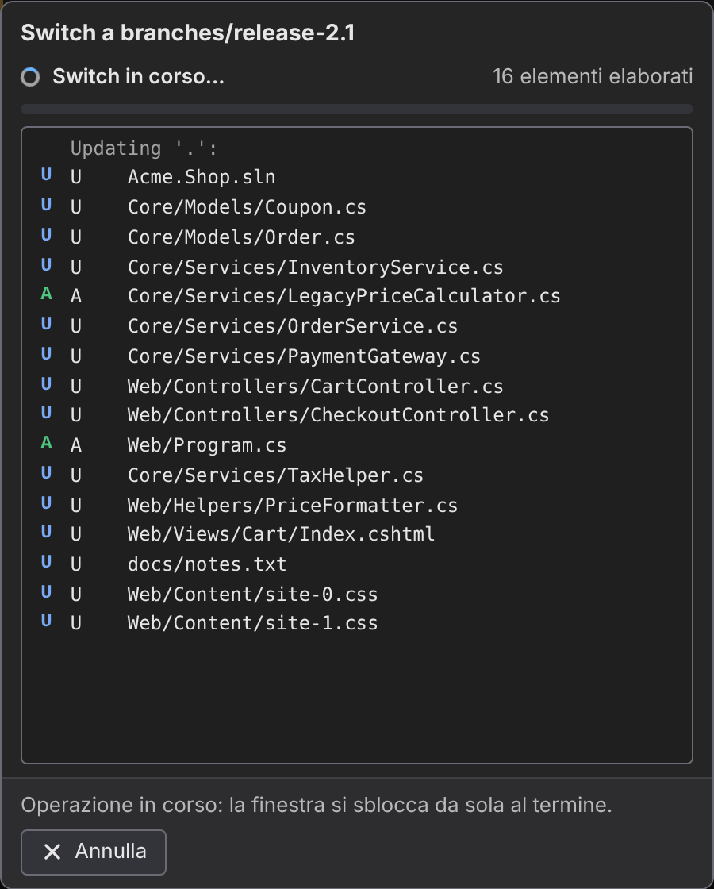
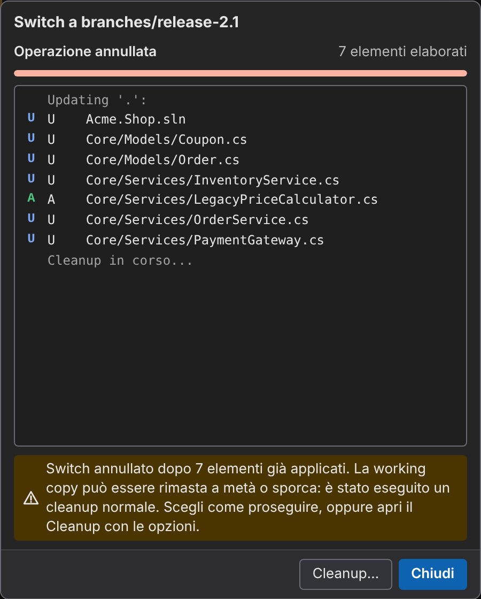
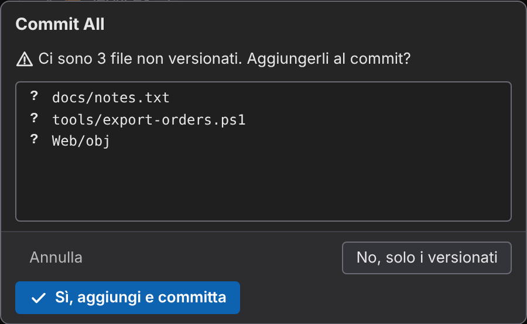

# SVNAssist 0.4.0

Data di rilascio: 2026-11-15.

Questa versione include le modifiche della 0.3.2, che non è stata rilasciata a parte.

## Novità

- **Selezione multipla in Changes.** Ctrl+clic aggiunge o toglie un elemento, Maiusc+clic seleziona un intervallo (anche tra sezioni). Da tastiera: Maiusc+frecce, Ctrl+Spazio, Ctrl+A. Il tasto destro mostra le azioni valide per tutta la selezione, con il conteggio. Spazio e Canc valgono per tutti gli elementi selezionati.

  

  *SVN Changes con tre file selezionati con Ctrl+clic e il menu del tasto destro: il titolo indica "Selezione: 3 elementi" e le voci riportano il conteggio.*
- **Canc sulle cartelle.** Una cartella versionata viene eliminata con svn delete (resta da committare); una non versionata va nel cestino. La conferma elenca gli elementi.
- **AI: Più corto e Più dettagliato.** Il menu del messaggio di commit ha queste due voci oltre a Genera.
- **Show Log: Stop on copy/rename.** L'opzione è spenta di default: il Log mostra la storia completa oltre le copie e le rinomine.
- **Show Log: Include merged revisions.** Le revisioni entrate per merge sono annidate sotto il merge; un merge inverso è segnalato.

  

  *Show Log con "Includi revisioni unite" attivo e "Ferma alla copia/rinomina" spento: le revisioni portate da un merge sono annidate sotto la r123 e il merge inverso è segnalato.*
- **Show Log: diff dei file di una revisione.** Un clic su un file di una revisione apre il diff di quella revisione, anche per le revisioni unite. Le opzioni si cambiano mentre il Log è aperto e il Log si ricarica.
- **Icone di stato SVN in Solution Explorer.** Normale, modificato, aggiunto, non versionato, conflitto, eliminato. Sono attive di default e si disattivano da Options. SVNAssist si registra come provider di source control solo per le soluzioni dentro una working copy SVN.
- **Menu di Solution Explorer.**
  - **Show Log** per file, progetto e cartella.
  - **SVN Add** per gli elementi non versionati, anche con selezione multipla.
  - **Check for Modifications** per i file modificati: apre il diff di Visual Studio rispetto a BASE.

  

  *Illustrazione: Esplora soluzioni con le icone di stato accanto ai file e il menu del tasto destro su un file modificato (Show Log, Check for Modifications). Le icone di stato sono schematiche: Visual Studio mostra le proprie icone standard di source control. Ricostruzione dell'aspetto, non uno screenshot di Visual Studio.*
- **Avviso prima dello Switch.** Se la working copy ha modifiche, compare un avviso con i conteggi per tipo e tre scelte: Continua comunque, Apri Cleanup, Annulla.

  

  *Avviso prima dello Switch verso branches/release-2.1: i conteggi per tipo (3 modificati, 1 aggiunto, 2 eliminati, 3 in conflitto, 3 non versionati) e le scelte Annulla, Apri Cleanup... e Continua comunque.*
- **Cleanup con opzioni.** Da ogni punto di avvio: Break locks, Fix timestamps, Vacuum pristines, Include externals. Le opzioni distruttive (Delete unversioned, Delete ignored, Revert) sono in rosso e chiedono conferma.
  - Delete unversioned e Delete ignored saltano sempre la cartella .vs e i file tenuti aperti da Visual Studio o dal debug. Il riepilogo indica "Eliminati N, saltati M perché in uso".
  - Con svn precedente alla 1.9 le opzioni oltre il cleanup semplice sono disabilitate.

  

  *SVN Cleanup con le opzioni: Break write locks e Fix time stamps (incluse nel cleanup), Vacuum pristine copies, Include externals e, in rosso sotto "Azioni distruttive", Delete unversioned, Delete ignored e Revert.*
- **Finestra di avanzamento** per Switch, Update e Merge. Mostra la fase corrente, le righe di svn in sequenza e i conflitti evidenziati. Il riepilogo finale ha il pulsante **Apri i conflitti**. L'avanzamento non ha percentuale: barra indeterminata e contatore.

  

  *Finestra di avanzamento dello Switch verso branches/release-2.1 durante l'operazione: la fase "Switch in corso...", il contatore degli elementi elaborati, le righe di svn e il pulsante Annulla.*
- **Annulla in Switch, Update e Merge.**
  - Switch o update annullato: esegue un cleanup, avvisa che la working copy può essere a metà e offre Cleanup..., Completa switch o Torna a prima dello switch (per l'update, Riprova update).
  - Merge annullato: offre il revert delle modifiche del merge (con conferma) oppure Lascia così.

  

  *Switch annullato dopo 7 elementi: il riepilogo avvisa che la working copy può essere rimasta a metà o sporca e propone Cleanup... e Chiudi.*
- **Torna a prima dello switch.** Ripristina l'URL e la revisione di partenza, salvati prima dello switch. Le modifiche locali restano.
- **Prerequisiti senza riavvio del PC.** Dopo l'installazione di svn, .NET o degli strumenti AI da riga di comando, SVNAssist rilegge il PATH aggiornato. Se un programma è presente ma non parte, il messaggio chiede di riavviare Visual Studio.

## Modifiche

- **Cartella .vs.** Resta tra i non versionati, per poterla ignorare, ma non rende modificata la working copy. Commit All e l'avviso dello Switch non la considerano.
- **Commit All con file nuovi.** Se ci sono file non versionati, chiede "Aggiungerli al commit?" con le scelte: Sì, aggiungi e committa; No, solo i versionati; Annulla. La domanda compare anche quando ci sono solo file nuovi. Commit Staged non cambia.

  

  *Commit All con tre file non versionati: la domanda "Aggiungerli al commit?" con le scelte Sì, aggiungi e committa; No, solo i versionati; Annulla.*
- **Show Log.** L'elenco parte da HEAD, come TortoiseSVN.
- **Errori dello switch.** Gli errori su più righe si mostrano per intero e si possono copiare.

## Correzioni

- **Show Log dopo un commit.** Prima: il commit appena fatto non compariva senza un update. Ora: compare subito.
- **"Switch incompleto".** Prima: la voce restava anche quando la working copy era coerente. Ora: viene tolta da sola se l'URL è quello di partenza o di destinazione e non ci sono cartelle switched o incomplete né lock.
- **Switch interrotto da E155009** (inclusa dalla 0.3.2). Prima: svn si fermava a metà quando una cartella era tenuta aperta (da Visual Studio, dal designer o da un antivirus); l'errore compariva su una riga troncata, l'intestazione mostrava il ramo vecchio, il selettore segnava il nuovo come "(corrente)" e rifiutava di rifare lo switch. Ora:
  - SVNAssist esegue cleanup, attende 2 secondi e ripete lo switch una volta.
  - Se lo switch resta a metà, l'errore lo dice e indica di non usare Revert. Il pulsante **Completa switch** esegue cleanup e lo stesso switch.
  - L'intestazione mostra "ramo (switch incompleto)" e il selettore indica la destinazione come "(switch incompleto)". Lo stato resta dopo la chiusura di Visual Studio.
  - Uno switch fallito senza toccare la working copy (URL sbagliato, credenziali) resta un errore normale.
  - L'errore E155009 propone Esegui Cleanup anche fuori dallo switch.
- **Errori su una riga.** Prima: gli errori lunghi comparivano troncati su una riga. Ora: vanno a capo nella barra in basso.

## Requisiti e installazione

- Visual Studio 2026 (18.x).
- Visual Studio 2022: dichiarata, non ancora provata (da verificare).
- Client svn 1.8 o successivo; per le opzioni di Cleanup oltre il cleanup semplice serve svn 1.9 o successivo.
- Runtime .NET 10.
- Se è installato un altro provider SVN (AnkhSVN, VisualSVN), Visual Studio chiede quale usare.

Installazione: come la 0.2.0.

Dettagli tecnici

Testo tecnico originale: `docs/release-notes/v0.4.0.md`; per le correzioni della 0.3.2: `docs/release-notes/v0.3.2.md`. Testo pubblicato in precedenza sulla Release: `docs/release-notes/archive/v0.4.0.github.md`.

- Cartella `.vs`: resta tra i non versionati ma non rende "sporca" la working copy; Commit All non la aggiunge.
- Canc su cartella versionata: `svn delete`. Show Log: `svn log -r HEAD:1`; Include merged revisions: `svn log -g`.
- Cleanup: Delete unversioned e Delete ignored sono eseguiti da SVNAssist e non con `svn --remove-*`; le opzioni oltre il cleanup semplice richiedono svn 1.9 o successivo.
- Solution Explorer: SVNAssist si registra come provider di source control solo per le soluzioni in una working copy SVN; Show Log vale anche per i progetti `.csproj` / `.vcxproj`.
- Switch interrotto: errore E155009; URL e revisione di partenza sono salvati prima dello switch e lo stato "switch incompleto" resta dopo il riavvio di Visual Studio. La voce viene rimossa se la working copy è coerente.
- Prerequisiti: il PATH viene riletto dal registro dopo l'installazione di svn, .NET o delle CLI AI.
- Limiti noti: avanzamento senza percentuale (svn non fornisce un totale); icone standard di Visual Studio, senza il "?" in stile Git per i non versionati.

