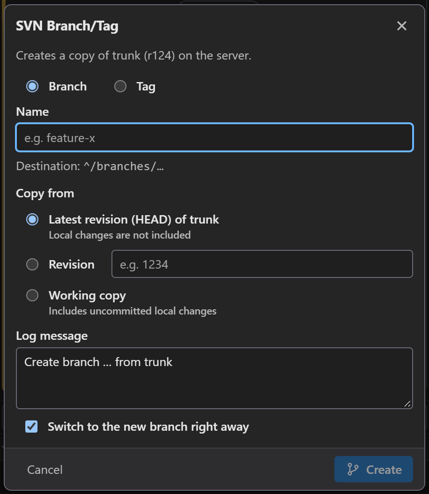
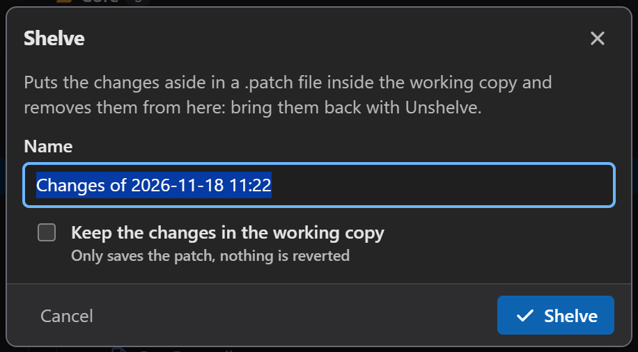
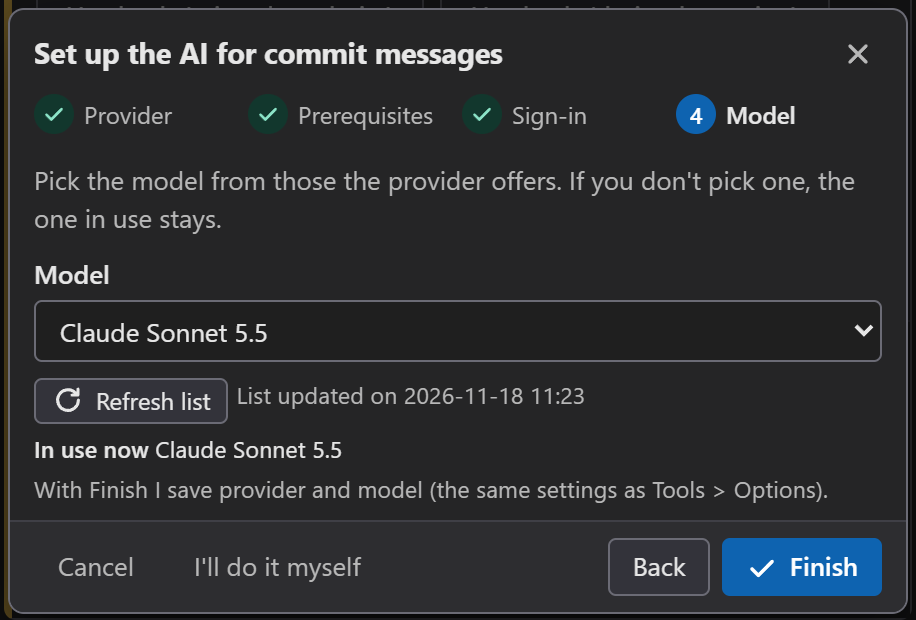

# SVNAssist 0.5.0

Contents: Branch/Tag, Create Patch, Apply Patch, Shelve, server checks at commit, locks by other users, conflict resolution by group, list of AI models from the provider, AI sign-in to redo with a button, model and cost in the generated message (option), Merge from folder, Merge applied one revision at a time.

## New

- **SVN Branch/Tag...** Creates a branch or a tag on the server from HEAD of the current branch, from a revision or from the working copy (with the local changes). It opens from the SVNAssist menu, from "More actions" in Changes and from the Switch selector.
  - The log message is pre-filled.
  - The option **Switch to the new branch right away** runs the switch after creation.
  - The name is checked. If it already exists, an error appears and the dialog stays open.

  

  *The SVN Branch/Tag dialog.*
- **Repository layout detected automatically.** If the URL does not match the layout set in the Options, SVNAssist recognizes the trunk/main, branches/branch and tags/tag folders. The detected layout is used by Switch, Merge, Branch/Tag and the branch label.
- **Create Patch... and Apply Patch...**
  - Create Patch saves the changes of a section, a file or a selection to a .patch file. It also includes unversioned files, as new files. Binary files and empty files are not included in the patch and are reported.
  - Apply Patch shows a preview with the files touched, the rejects and the conflicts, and applies the patch after confirmation.
  - Patches use relative paths and can also be applied to another working copy.
- **Shelve... / Unshelve.** Sets the changes aside, like git stash.
  - Asks for a name and the option **Keep the changes in the working copy**.
  - The **Shelved (n)** section in Changes lists the saved sets. The menu has Unshelve, Apply and keep, Save as .patch and Delete.
  - Binary files and empty files stay where they are; the warning before proceeding gives the reason for each file: (empty), (binary) or (open in another program).

  

  *The Shelve dialog, opened from the right-click menu on a file.*
- **Backup before mass reverts.** Before Revert everything and Undo merge, the local changes are saved in a hidden folder of the working copy, which does not appear among the unversioned files.
  - After the operation the **Restore changes** button reapplies them.
  - The backup is deleted after the restore or at the next operation. Backups older than 7 days or over 200 MB are deleted at startup.
  - If there is not enough disk space, SVNAssist asks whether to proceed without a backup.
- **Server check at commit.** Before the commit SVNAssist checks whether there are revisions from other users on the branch. In that case it warns that the working copy does not contain them and offers SVN Update. If the commit happens anyway, after the commit a warning and the **SVN Update now** button appear; the revision indicator stays orange.
- **Warning on conflict markers.** At commit, if a file contains conflict markers (even indented), a warning appears asking for confirmation.
- **Locks by other users.** In Changes a lock with "Locked by <user>" marks the files locked by others; the tooltip shows the date and the comment. It is updated by the periodic check for new revisions.
- **Use mine for all / Use theirs for all.** Resolve the text conflicts together, with confirmation and a list of files. Tree and property conflicts are excluded.
- **Use both.** In the resolution of a text conflict, merges the two versions: mine followed by theirs, or theirs followed by mine. Also available for all conflicts.
- **Mark as resolved on the open file.** When a conflicted file is open in Visual Studio, a bar above the document offers Mark as resolved, Use mine, Use theirs, Use both and Open merge editor.
- **Right-click menu.** In the Conflicts panel of Changes and in the Log, right-click on the selected rows opens a menu of actions (also with Shift+F10 or the Menu key). For conflicts it includes Open file and Copy path. The Changes row menu also includes opening the file in File Explorer.
- **AI models from the provider.** The model selection shows the list returned by the provider, without "recommended" entries.
  - **Refresh list** rereads the list; otherwise it is reread after 24 hours.
  - **Other…** lets you type the name of a model that is not in the list.
  - The list always comes from the connected provider: SVNAssist has no model lists of its own. If the provider is not connected or does not answer, the list shows "Not connected" with a prompt to connect it. With Claude Code (subscription) the list needs an Anthropic API key. In Tools > Options the model is a text field.
  - With GitHub Copilot the estimated cost per commit (premium multiplier), the default model, the model used and the connected account are shown.
  - If the model does not respond, the error reports the reason given by the provider and suggests an action.
  - **Sign in again.** If generation fails because the provider sign-in has expired or is missing (expired session, not connected, invalid key), the **Sign in again** button appears next to the error. It opens the setup on the Sign-in step: with GitHub Copilot and Claude Code it starts the login in a terminal right away, with an API key it lets you paste a new one. At the end, Finish regenerates the message.
  - **Show model and cost in the generated message.** Option in Tools > Options > SVNAssist > Commit message AI, off by default. When on, the status line after Generate with AI shows the model used and the cost declared by the provider (with GitHub Copilot, premium requests). If the provider does not declare a valid cost, "cost not available" appears: SVNAssist never estimates a cost. With the option off, only Copilot shows the model used.

  

  *The Model step of the setup: the list comes from the provider.*
  - Not tested with the real providers.
- **Merge from a folder.** SVN Merge... from a folder in Solution Explorer works only on that subtree. A verdict shows whether the folder is Compatible with the merge or whether the merge is not possible.
- **Files of each revision.** In the selection of the revisions to merge, below the table a list of the files involved appears (A, M, D). A click on a file opens the diff of that revision.
- **Merge preview by revision.** The preview is grouped by revision, with the files of each one. Files with a predicted conflict are marked with a red C and with the number of possible conflicts.
- **Show Log: changed paths.** For the selected revision, the Log lists the changed paths with the counts by action. The option **Only affected paths** hides the paths outside the file or folder from which the Log was opened.
- **Merge with pending changes.** The merge is no longer blocked by uncommitted changes. A warning appears with the number of changed items and the files in common with the merge. Before the merge the changes are copied to a safety folder. Undo merge restores the pending changes as well as undoing the merge. After the merge commit the copy is deleted.
- **Merge applied one revision at a time.** The merge proceeds with the progress "revision N of TOT (rNNNNN)". If a revision conflicts, the merge stops.
  - The message states what has been applied, what remains and what to do: resolve the conflicts, mark them as resolved, choose Continue merge. The merge does not need to be redone.
  - **Continue merge** applies only the remaining revisions.
  - The state is saved to disk: the merge can be resumed after restarting Visual Studio.
  - The "Merge interrupted" banner in Changes and in the Log shows applied, remaining and steps to take, with the buttons Continue merge, Undo merge and Discard state.
- **Progress with percentage.** Switch, Update and Update to revision show a bar with percentage and "N of about M items" when the total can be determined (maximum wait of 10 seconds). Otherwise the indeterminate bar remains.
- **Update to revision with progress window** and a Cancel button.
- **More complete status.** Changes recognizes property conflicts, obstructed items, incomplete items and tree conflicts.
- **AI limits per provider.** The length of the diff sent and of the response depend on the provider, instead of a single limit applied to all.

## Changes

- **Update to revision.** The list shows only the revisions of the current branch.
- **Mark as resolved.** If the file is identical to the base version (for example because the choice was removed in the merge editor), SVNAssist warns before proceeding.
- **Merge.** Revisions are read without the list of files, in parallel and cached. The timing of each phase is written to the SVNAssist log. The effect on merge time has not been measured.

## Fixes

- **Recent.** Before: clicking an entry in Recent did not select or write the text; it appeared only after pressing another button. Now: the chosen text appears in the field immediately.
- **Merge progress.** Before: it appeared twice, in the Changes window and in the Log tab. Now: the full window is shown only in the view from which the operation starts; in the other one a strip appears that does not block.
- **Progress while idle.** Before: the progress window showed "0 items" before the start. Now: it shows a text indicating the wait.
- **Merge stopped by a conflict.** Before: the error appeared several times and Changes did not refresh. Now: Changes shows the Conflicts section and only one message appears.
- **Update to revision.** Before: choosing a revision earlier than the creation of the branch gave an error. Now: the list contains only the revisions of the branch.
- **Create Patch with files open in other programs.** Before: if the selected unversioned items included a file open exclusively (for example in the Visual Studio .vs folder), the patch was not created ("The process cannot access the file"). Now: the .vs folder is not part of the patch and a file open in another program is reported among the excluded ones.
- **Conflict warning after a merge.** Before: after resolving the conflicts in Changes, the merge result kept showing "N in conflict". Now: the number follows the real state of the working copy and the warning disappears when no conflicts remain.
- **Login from the terminal.** Before: the terminal opened by Sign in (for example for Claude Code) closed immediately. Now: it stays open.

## Requirements and installation

- Visual Studio 2026 (18.x): tested.
- Visual Studio 2022 (17.x): declared as supported, not yet tested.

Installation: same as 0.2.0.
