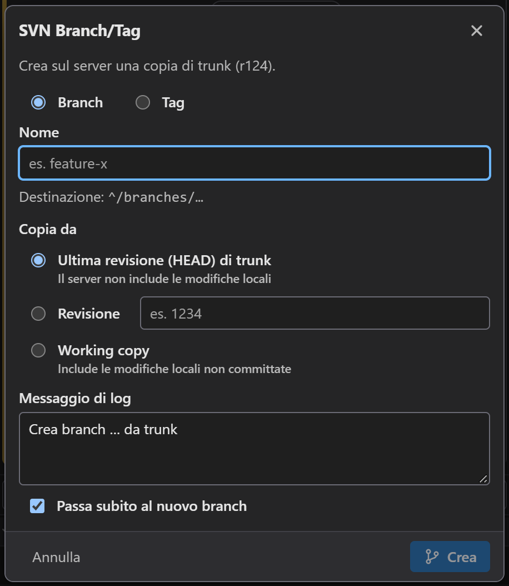
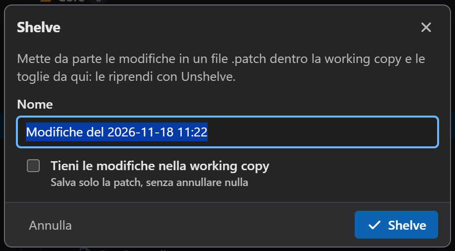
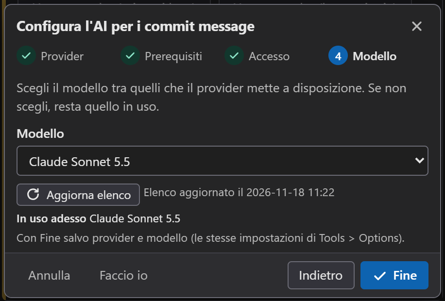

# SVNAssist 0.5.0

Contenuti: Branch/Tag, Create Patch, Apply Patch, Shelve, controlli sul server al commit, lock di altri utenti, risoluzione dei conflitti per gruppo, elenco dei modelli AI dal provider, accesso AI da rifare con un pulsante, modello e costo nel messaggio generato (opzione), Merge da cartella, Merge applicato una revisione alla volta.

## Novità

- **SVN Branch/Tag...** Crea un branch o un tag sul server a partire da HEAD del ramo corrente, da una revisione o dalla working copy (con le modifiche locali). Si apre dal menu SVNAssist, da "Altre azioni" in Changes e dal selettore di Switch.
  - Il messaggio di log è precompilato.
  - L'opzione **Passa subito al nuovo branch** esegue lo switch dopo la creazione.
  - Il nome viene controllato. Se esiste già, compare un errore e il dialogo resta aperto.

  

  *Il dialogo SVN Branch/Tag.*
- **Layout del repository rilevato da solo.** Se l'URL non corrisponde al layout impostato nelle Options, SVNAssist riconosce le cartelle trunk/main, branches/branch e tags/tag. Il layout rilevato è usato da Switch, Merge, Branch/Tag e dall'etichetta del ramo.
- **Create Patch... e Apply Patch...**
  - Create Patch salva le modifiche di una sezione, di un file o di una selezione in un file .patch. Include anche i file non versionati, come file nuovi. Binari e file vuoti non entrano nella patch e vengono segnalati.
  - Apply Patch mostra un'anteprima con i file toccati, i rifiuti e i conflitti, e applica la patch dopo la conferma.
  - Le patch usano percorsi relativi e si applicano anche su un'altra working copy.
- **Shelve... / Unshelve.** Mette da parte le modifiche, come git stash.
  - Chiede un nome e l'opzione **Tieni le modifiche nella working copy**.
  - La sezione **Shelved (n)** in Changes elenca i salvataggi. Il menu ha Unshelve, Applica e tieni, Salva come .patch ed Elimina.
  - Binari e file vuoti restano dove sono; l'avviso prima di procedere indica per ogni file il motivo: (vuoto), (binario) o (aperto da un altro programma).

  

  *Il dialogo Shelve, aperto dal menu del tasto destro su un file.*
- **Backup prima dei revert di massa.** Prima di Revert di tutto e di Annulla merge, le modifiche locali vengono salvate in una cartella nascosta della working copy, che non compare tra i non versionati.
  - Dopo l'operazione il pulsante **Ripristina modifiche** le riapplica.
  - Il backup viene eliminato dopo il ripristino o alla prossima operazione. I backup oltre 7 giorni o 200 MB vengono eliminati all'avvio.
  - Se manca spazio su disco, SVNAssist chiede se procedere senza backup.
- **Controllo del server al commit.** Prima del commit SVNAssist verifica se sul ramo ci sono revisioni di altri utenti. In quel caso avvisa che la working copy non le contiene e propone SVN Update. Se il commit avviene comunque, dopo il commit compaiono un avviso e il pulsante **SVN Update ora**; l'indicatore della revisione resta arancione.
- **Avviso sui marcatori di conflitto.** Al commit, se un file contiene marcatori di conflitto (anche rientrati), compare un avviso con la richiesta di conferma.
- **Lock di altri utenti.** In Changes un lucchetto con "Bloccato da <utente>" indica i file bloccati da altri; il tooltip riporta data e commento. Si aggiorna con il controllo periodico delle nuove revisioni.
- **Usa la mia per tutti / Usa la loro per tutti.** Risolvono insieme i conflitti di testo, con conferma e elenco dei file. Conflitti ad albero e di proprietà sono esclusi.
- **Usa entrambe.** Nella risoluzione di un conflitto di testo, unisce le due versioni: la mia seguita dalla loro, oppure la loro seguita dalla mia. Disponibile anche per tutti i conflitti.
- **Segna come risolto sul file aperto.** Quando in Visual Studio è aperto un file in conflitto, una barra sopra il documento offre Segna come risolto, Usa la mia, Usa la loro, Usa entrambe e Apri editor di merge.
- **Menu del tasto destro.** Nel riquadro Conflitti di Changes e nel Log il tasto destro sulle righe selezionate apre un menu di azioni (anche con Maiusc+F10 o il tasto Menu). Nei conflitti include Apri file e Copia percorso. Nel menu di riga di Changes c'è anche l'apertura del file in Esplora file.
- **Modelli AI dal provider.** La scelta del modello mostra l'elenco restituito dal provider, senza voci "consigliato".
  - **Aggiorna elenco** rilegge l'elenco; altrimenti viene riletto dopo 24 ore.
  - **Altro...** permette di scrivere il nome di un modello non in elenco.
  - L'elenco viene sempre dal provider collegato: SVNAssist non ha elenchi di modelli propri. Se il provider non è collegato o non risponde, al posto della tendina compare "Non collegato" con l'invito a collegarlo. Con Claude Code (abbonamento) l'elenco richiede una API key Anthropic. In Tools > Options il modello è un campo di testo.
  - Con GitHub Copilot sono indicati il costo stimato per commit (moltiplicatore premium), il modello predefinito, il modello usato e l'account collegato.
  - Se il modello non risponde, l'errore riporta il motivo del provider e propone un'azione.
  - **Rifai l'accesso.** Se la generazione fallisce perché l'accesso al provider è scaduto o mancante (sessione scaduta, non collegato, chiave non valida), accanto all'errore compare il pulsante **Rifai l'accesso**. Apre la procedura sul passo Accesso: con GitHub Copilot e Claude Code lancia subito il login in un terminale, con una API key permette di incollarne una nuova. Alla fine, Fine rigenera il messaggio.
  - **Mostra modello e costo nel messaggio generato.** Opzione in Tools > Options > SVNAssist > Commit message AI, spenta di default. Se attiva, la riga di stato dopo Genera con AI scrive il modello usato e il costo dichiarato dal provider (con GitHub Copilot, le richieste premium). Se il provider non dichiara un costo valido compare "costo non disponibile": SVNAssist non stima mai un costo. Con l'opzione spenta, con Copilot compare solo il modello usato.

  

  *Il passo Model della procedura guidata: l'elenco viene dal provider.*
  - Non provato con i provider reali.
- **Merge da una cartella.** SVN Merge... da una cartella di Solution Explorer lavora solo su quel sottoalbero. Un verdetto indica se la cartella è Compatibile con il merge o se il merge non è possibile.
- **File di ogni revisione.** Nella selezione delle revisioni da unire, sotto la tabella compare l'elenco dei file coinvolti (A, M, D). Un click su un file apre il diff di quella revisione.
- **Anteprima del merge per revisione.** L'anteprima è raggruppata per revisione, con i file di ciascuna. I file con un conflitto previsto sono indicati con una C rossa e dal numero di possibili conflitti.
- **Show Log: percorsi modificati.** Per la revisione scelta, il Log elenca i percorsi modificati con i conteggi per azione. L'opzione **Solo percorsi interessati** nasconde i percorsi fuori dal file o dalla cartella da cui è stato aperto il Log.
- **Merge con modifiche pendenti.** Il merge non è più bloccato da modifiche non committate. Compare un avviso con il numero di elementi modificati e i file in comune con il merge. Prima del merge le modifiche vengono copiate in una cartella di sicurezza. Annulla merge ripristina le modifiche pendenti oltre ad annullare il merge. Dopo il commit del merge la copia viene eliminata.
- **Merge applicato una revisione alla volta.** Il merge procede con l'avanzamento "revisione N di TOT (rNNNNN)". Se una revisione va in conflitto, il merge si ferma.
  - Il messaggio indica cosa è stato applicato, cosa manca e cosa fare: risolvere i conflitti, segnarli come risolti, scegliere Continua merge. Non serve rifare il merge.
  - **Continua merge** applica solo le revisioni rimaste.
  - Lo stato è salvato su disco: il merge si può riprendere dopo il riavvio di Visual Studio.
  - Il banner "Merge interrotto" in Changes e nel Log mostra applicate, rimaste e passi da fare, con i pulsanti Continua merge, Annulla merge e Scarta stato.
- **Avanzamento con percentuale.** Switch, Update e Update to revision mostrano una barra con percentuale e "N di circa M elementi" quando il totale si ricava (massimo 10 secondi di attesa). Altrimenti resta la barra indeterminata.
- **Update to revision con finestra di avanzamento** e pulsante Annulla.
- **Stato più completo.** Changes riconosce conflitti di proprietà, elementi ostruiti, elementi incompleti e tree conflict.
- **Limiti dell'AI per provider.** La lunghezza del diff inviato e quella della risposta dipendono dal provider, invece di un unico limite applicato a tutti.

## Modifiche

- **Update to revision.** L'elenco mostra solo le revisioni del ramo corrente.
- **Segna come risolto.** Se il file è uguale alla versione di base (per esempio perché la scelta è stata tolta nell'editor di merge), SVNAssist avvisa prima di procedere.
- **Merge.** Le revisioni vengono lette senza l'elenco dei file, in parallelo e memorizzate. I tempi di ogni fase vengono scritti nel log di SVNAssist. L'efficacia sul tempo di merge non è stata misurata.

## Correzioni

- **Recenti.** Prima: cliccando una voce in Recent il testo non veniva selezionato né scritto; compariva dopo aver premuto un altro pulsante. Ora: il testo scelto compare subito nel campo.
- **Avanzamento del merge.** Prima: compariva due volte, nella finestra Changes e nella scheda Log. Ora: la finestra completa si vede solo nella vista da cui parte l'operazione; nell'altra compare una striscia che non blocca.
- **Avanzamento da fermo.** Prima: la finestra di avanzamento mostrava "0 elementi" prima dell'inizio. Ora: mostra un testo che indica l'attesa.
- **Merge fermato da un conflitto.** Prima: l'errore compariva più volte e Changes non si aggiornava. Ora: Changes mostra la sezione Conflitti e compare un solo messaggio.
- **Update to revision.** Prima: scegliendo una revisione precedente alla creazione del ramo si otteneva un errore. Ora: l'elenco contiene solo le revisioni del ramo.
- **Create Patch con file aperti da altri programmi.** Prima: se tra i non versionati selezionati c'era un file aperto in esclusiva (per esempio nella cartella .vs di Visual Studio), la patch non veniva creata ("Il processo non può accedere al file"). Ora: la cartella .vs non entra nella patch e un file aperto da un altro programma viene segnalato tra quelli esclusi.
- **Avviso di conflitti dopo il merge.** Prima: dopo aver risolto i conflitti in Changes, il risultato del merge continuava a mostrare "N in conflitto". Ora: il numero segue lo stato reale della working copy e l'avviso sparisce quando non restano conflitti.
- **Login dal terminale.** Prima: il terminale aperto da Accedi (per esempio per Claude Code) si chiudeva subito. Ora: resta aperto.

## Requisiti e installazione

- Visual Studio 2026 (18.x): provato.
- Visual Studio 2022 (17.x): dichiarato come supportato, non ancora provato.

Installazione: come la 0.2.0.

Dettagli tecnici

Testo tecnico originale: `docs/release-notes/v0.5.0.md`.

- Branch/Tag: `repoLayout` nelle Options; il layout rilevato (trunk/main, branches/branch, tags/tag) è usato da Switch, Merge, Branch/Tag e dall'etichetta del ramo.
- Patch: Create Patch e Apply Patch con anteprima `svn patch --dry-run`; percorsi relativi; file non versionati inclusi come nuovi file (diventano A).
- Backup: `<working copy>\.svn-assist\backups`, escluso dai non versionati; pulizia automatica oltre 7 giorni o 200 MB.
- Shelve: patch in `<working copy>\.svn-assist\shelves`, sezione Shelved (n) in Changes.
- Commit: controllo HEAD sul server prima del commit; avviso sui marcatori di conflitto `<<<<<<<` / `=======` / `>>>>>>>`.
- Lock: lucchetto "Bloccato da <utente>" da controllo HEAD periodico.
- Conflitti: Usa la mia / Usa la loro per tutti esclusi i conflitti ad albero e di proprietà; stato più completo (proprietà, ostruiti, incompleti, tree conflict).
- Avanzamento: percentuale da `svn diff --summarize`, massimo 10 secondi; altrimenti barra indeterminata.
- AI: limiti per provider (lunghezza del diff, token di risposta).
- Note di collaudo: provato su Visual Studio 18 (2026); il manifest dichiara anche VS 2022 (17.x), non provato.

