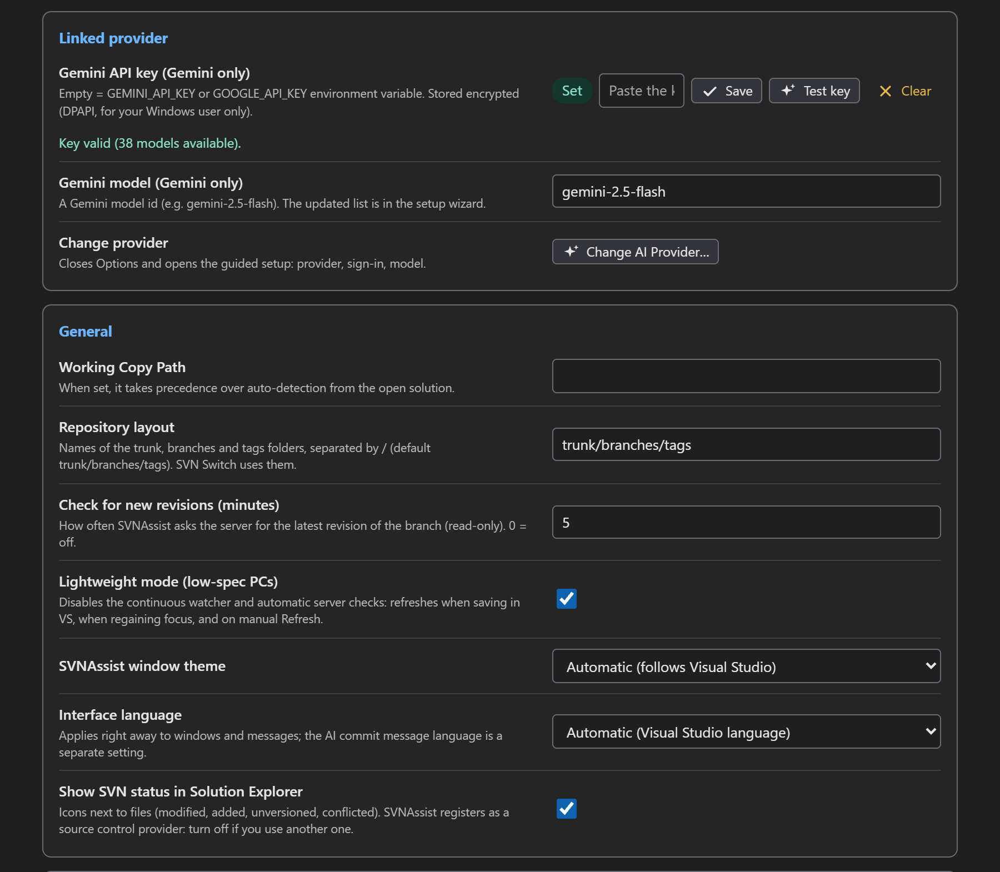
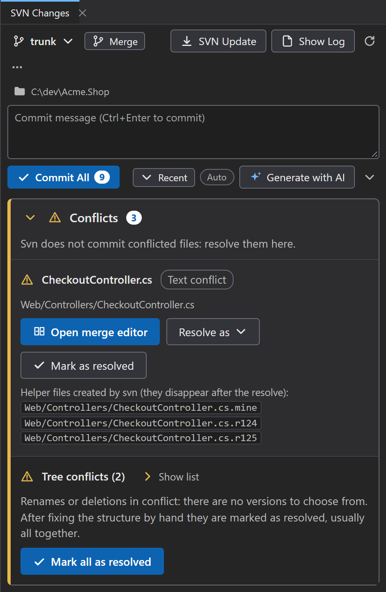
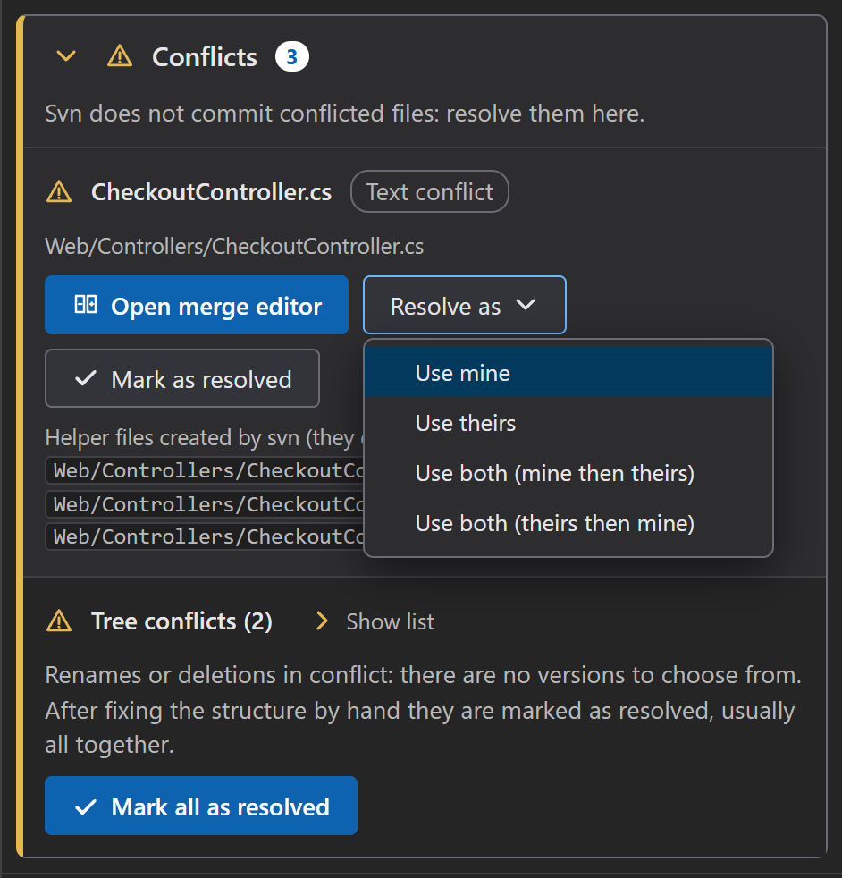
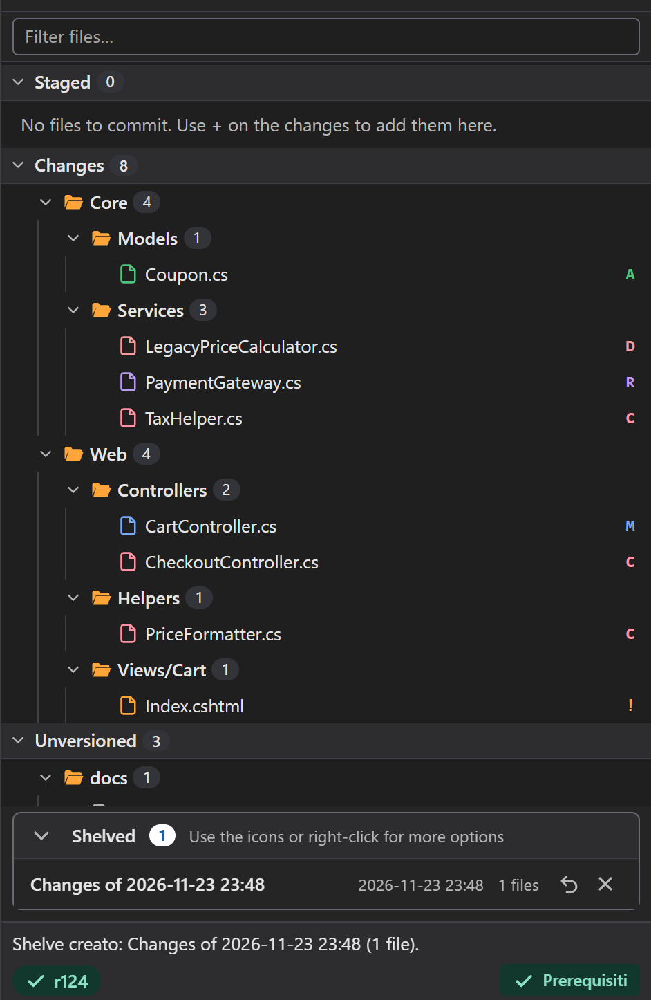
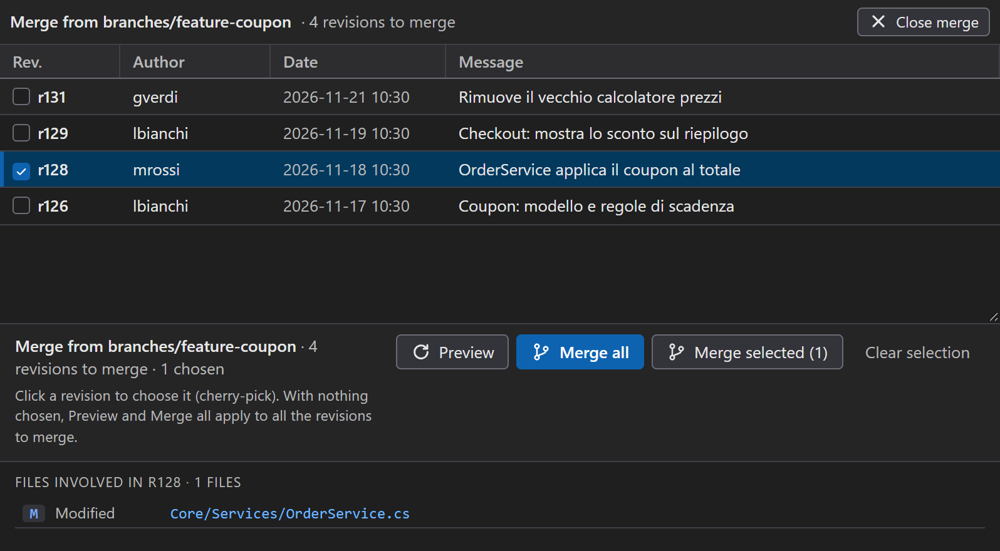

# SVNAssist 0.7.0

Contents: Lightweight mode for low-spec PCs and automatic pause during builds, 300-row initial cap per section, Test key button in Options, active AI provider label, clickable working copy path, Merge button in the Changes header, Resolve as menu on conflicts, inline actions on Shelved rows, per-instance VS merge editor.

## New

- **Lightweight mode (low-spec PCs).** New option under `Tools > Options > SVNAssist > General`, off by default: disables the continuous disk watcher and automatic server revision checks.
  - With the option enabled, status refreshes when saving a file in Visual Studio, when Visual Studio regains focus (with a 5-second minimum interval), and on manual Refresh.
- **Test key in Tools > Options.** Next to the API key field for Claude API, OpenAI-compatible / GitHub Models and Gemini, a **Test key** button is now available.
  - A click saves any pasted key (encrypted for your Windows user), queries the selected provider and displays the count of available models or the returned error below the row.

  

  *Linked provider settings with Test key and General settings with Lightweight mode (low-spec PCs).*
- **Active AI provider label in the commit bar.** Next to **Generate with AI**, a button shows the active provider and model (or `Auto`). Clicking it opens the guided setup to switch provider or model.
- **Clickable working copy path in SVN Changes.** Below the header, the current working copy folder path is displayed. Clicking it opens the folder input box directly without opening the **More actions** menu; `Esc` closes it.
- **Merge button in the Changes header.** The **Merge** button now sits directly next to the branch selector in the SVN Changes header, in addition to the item under **More actions**.

## Changes

- **Conflicts panel with Resolve as menu.** Each text conflict keeps **Open merge editor** and **Mark as resolved** directly visible; **Use mine**, **Use theirs**, **Use both (mine then theirs)** and **Use both (theirs then mine)** move inside the **Resolve as** menu. With 2 or more text conflicts, bulk actions move into a single **Resolve all as** menu.

  

  *The SVN Changes panel with the Merge button, working copy path, AI provider label and Conflicts panel.*

  

  *The Resolve as menu showing the four resolution options per file.*
- **Inline actions on Shelved rows.** Each row inside **Shelved (n)** displays direct icon buttons for **Unshelve** and **Delete**, while keeping the full right-click menu.

  

  *The expanded Shelved (1) section showing inline buttons to apply or delete the shelve.*
- **Merge view header in the Log.** Title, revision count, hint text and **Preview**, **Merge all**, **Merge selected (n)** and **Clear selection** buttons are placed side by side across the top bar of the Merge view.

  

  *The Merge view header in the Log with title, description and action buttons in the top strip.*
- **Lower workload on large solutions and during builds.**
  - **Staged**, **Changes** and **Unversioned** initially render 300 rows per section, with a **Show all (N hidden)…** button to expand the full list.
  - Automatic refresh pauses during builds and solution loading, extends quiet wait times after burst disk writes (`1.5 s` to `10 s`), and filters out NuGet `packages` folders, `TestResults` and temporary build files.
  - Hidden SVNAssist panes suspend after 5 seconds; Solution Explorer status icons update in batches of 8 projects and only when state changes.
  - Periodic remote lock checks skip server queries when no versioned files are modified.
- **Gemini included in Automatic when a key is set.** When **AI provider for commit messages** is set to `Automatic`, Gemini is tried after Copilot, Claude Code, Claude API and OpenAI-compatible whenever a Gemini API key or environment variable is configured; default model `gemini-2.5-flash`.

## Fixes

- **Merge editor with multiple Visual Studio instances open.** Before: opening conflict merge from `SVN Changes` with two or more Visual Studio windows open could open in the other window and fail to record saved changes. Now: when TortoiseMerge is not used, the merge editor opens inside the active Visual Studio instance and detects state on save and close.
- **Startup error on diff navigation shortcuts.** Before: Visual Studio startup could log an invalid-argument error for `Alt+F8` and `Shift+Alt+F8`. Now: shortcut initialization matches existing bindings even under localized scope names and eliminates the startup error.
- **Line revert at the end of a diff file.** Before: reverting the final hunk near the end of a file could exceed valid line bounds. Now: line bounds are checked before applying the revert.
- **Files outside the working copy and temporary resources.** Before: checking files outside a working copy repeated Subversion probes and shutdown could leave temporary folders or open stream readers behind. Now: verified external roots are cached and temporary folders are cleaned up on shutdown.

## Requirements and installation

- Visual Studio 2026 (18.x): tested.
- Visual Studio 2022 (17.x): declared as supported, not yet tested.
- .NET 10 Runtime (offered automatically if missing).

Installation: replaces 0.6.1. Close Visual Studio and run the release VSIX file.

Technical details

Checklist and live VS 18 verification (`/rootSuffix:SvnHost`): `docs/verifica/0.7.0/checklist.md`.

- Measured benchmark `v0.6.1` vs `0.7.0`:
  - UI Web DOM `1,500` files: `29.334 ms` / `2366.6 KB` / `1552` nodes → `5.306 ms` (−81.9%) / `457.1 KB` (−80.7%) / `302` nodes (−80.5%).
  - UI Web DOM `3,000` files: `52.157 ms` / `4663.8 KB` / `3052` nodes → `5.436 ms` (−89.6%) / `457.3 KB` (−90.2%) / `302` nodes (−90.1%).
  - `200× GetSnapshot()` on `2,000` files (`2,051` rows): `1058.18 ms` / `713.39 MB` allocated → `336.17 ms` (−68.2%, `252.77 ms` in `LightweightMode`) / `207.85 MB` (−70.9%).
  - Build FS watcher burst (`200` events): `4` `svn status` scans → `1` (normal) / `0` during build + `1` on focus return in `LightweightMode`; `IsNoise` `5/10` → `8/10`; remote lock queries on clean WC `1` → `0`.
- Host / VS SDK (`net472`):
  - `SVNAssistPackage`: `ShortcutBinding` (`src/Shared/DiffNav.cs`) normalizes and compares bindings (`CmdNextChange` / `CmdPrevChange` via `CmdSet` GUID + ID) and detects localized scope prefixes from `File.SaveAll`.
  - `HostService.OpenMergeAsync`: uses in-process `IVsFileMergeService` with `MergeFrameMonitor` (`IVsWindowFrameNotify3`); `MergeEditor.TryLaunch` skips `vsDiffMerge.exe` when multiple `devenv` processes are running.
  - `IdeActivityTracker` + `RefreshDebouncer.SetPaused` + `LightweightMode` + `ChangesStore.OnIdeActiveChanged` (`LightweightFocusCooldown = 5 s`) + `ConflictInfoBars.OnAfterSave`.
  - `SvnSccService` async batches of `8` projects via `Task.Yield()` + `_paintedRoot` diffing; `RevertMarginProvider` scoped to `PredefinedTextViewRoles.DifferenceViewerRoles` with opt-in logging (`SVNASSIST_LOG_MARGIN=1`); `WebViewHost` suspends hidden WebView2 after `5 s` (`TrySuspendAsync`) and coalesces `_deferredStateJson`; bounded `ConcurrentQueue` host logger (`MaxQueueSize = 2048`).
  - `settingsTestKey` (`HostService.TestApiKeyAsync`) -> `IBackend.ListAiModelsAsync(provider, forceRefresh: true)`.
  - Zero compiler/analyzer warnings across Backend, Tests (`net10.0` + `net472`), Shared and Host.

