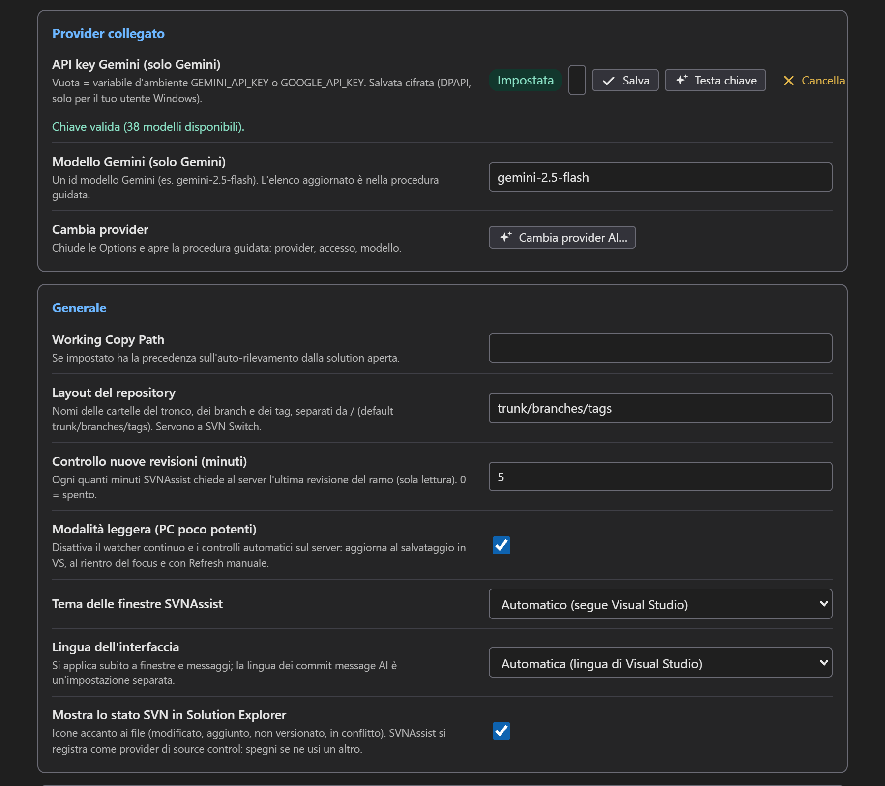
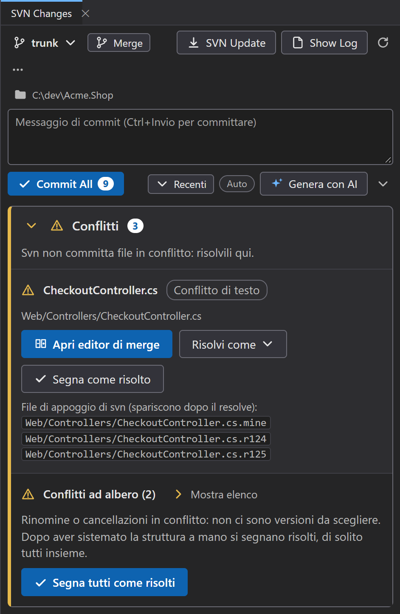
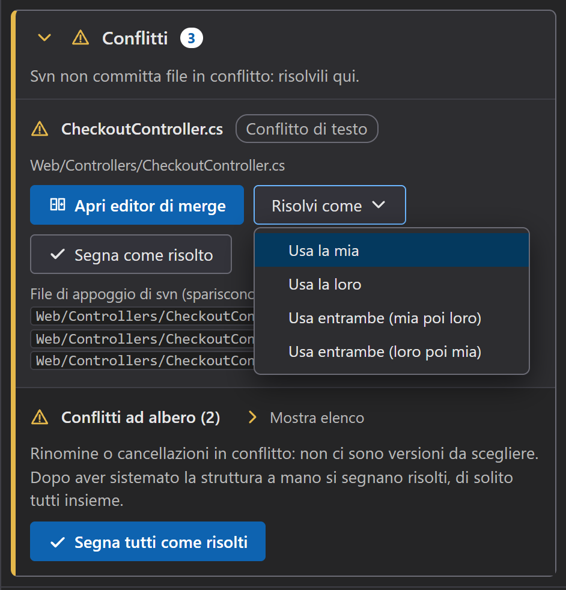
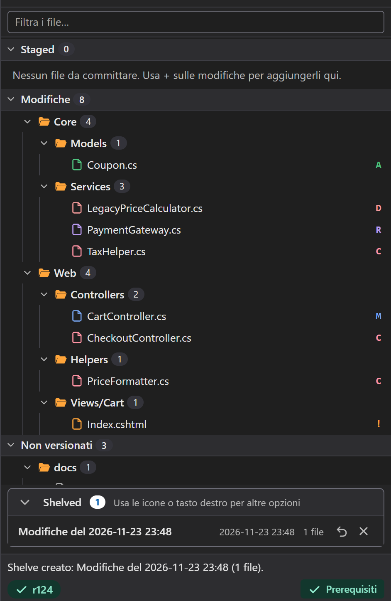
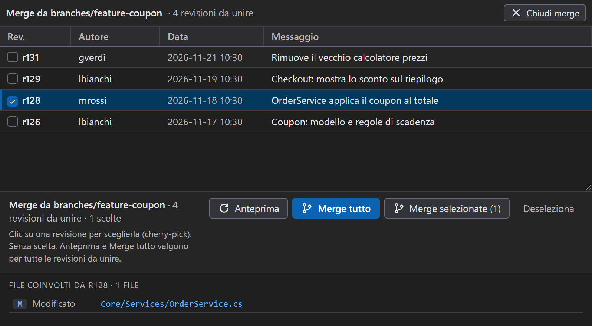

# SVNAssist 0.7.0

Contenuti: Modalità leggera per PC poco potenti e pausa automatica in compilazione, limite iniziale a 300 righe per sezione, Testa chiave in Options, badge provider AI, percorso working copy apribile con click, Merge nell'intestazione di Changes, menu Risolvi come sui conflitti, azioni inline su Shelved, editor di merge isolato per istanza VS.

## Novità

- **Modalità leggera (PC poco potenti).** Nuova opzione in `Tools > Options > SVNAssist > Generale`, spenta di default: disattiva il watcher continuo su disco e il controllo periodico delle revisioni sul server.
  - Con l'opzione attiva lo stato si aggiorna quando salvi un file in Visual Studio, quando la finestra di Visual Studio torna in primo piano (con intervallo minimo di 5 secondi) e alla pressione di Refresh.
- **Testa chiave in Tools > Options.** Accanto alla chiave API di Claude API, OpenAI-compatibile / GitHub Models e Gemini compare il pulsante **Testa chiave**.
  - Un click salva l'eventuale chiave incollata (cifrata per il tuo utente Windows), interroga il provider scelto e mostra sotto la riga il numero di modelli disponibili oppure l'errore restituito.

  

  *Le impostazioni Provider collegato con Testa chiave e Generale con Modalità leggera (PC poco potenti).*
- **Provider AI attivo nella barra di commit.** Accanto a **Genera con AI** compare il nome del provider e del modello in uso (oppure `Auto`). Un click apre la procedura guidata per cambiare provider o modello.
- **Percorso della working copy in SVN Changes.** Sotto l'intestazione compare il percorso della working copy corrente. Un click apre il campo di testo per cambiare cartella; `Esc` chiude il campo senza aprire il menu **Altre azioni**.
- **Pulsante Merge nell'intestazione di Changes.** Il comando **Merge** compare direttamente accanto al selettore del branch nell'intestazione di SVN Changes, in aggiunta alla voce in **Altre azioni**.

## Modifiche

- **Riquadro Conflitti con menu Risolvi come.** Su ogni conflitto di testo restano visibili **Apri editor di merge** e **Segna come risolto**; **Usa la mia**, **Usa la loro**, **Usa entrambe (mia poi loro)** e **Usa entrambe (loro poi mia)** passano nel menu **Risolvi come**. Con 2 o più conflitti di testo, le azioni globali si raccolgono nell'unico menu **Risolvi tutti come**.

  

  *Il pannello SVN Changes con il pulsante Merge, il percorso della working copy, il badge AI e il riquadro Conflitti.*

  

  *Il menu Risolvi come con le quattro opzioni di risoluzione per file.*
- **Azioni dirette sugli Shelved.** Ogni riga della sezione **Shelved (n)** mostra le icone dirette per **Unshelve** e **Elimina**, oltre al menu completo del tasto destro.

  

  *La sezione Shelved (1) espansa con i pulsanti diretti per applicare ed eliminare lo shelve.*
- **Testata della vista Merge nel Log.** Titolo, conteggio delle revisioni e i pulsanti **Anteprima**, **Merge tutto**, **Merge selezionate (n)** e **Deseleziona** sono disposti affiancati nella fascia superiore della vista Merge.

  

  *La testata della vista Merge nel Log con titolo, descrizione e pulsanti nella fascia superiore.*
- **Riduzione del carico su solution grandi e durante la compilazione.**
  - Le sezioni **Staged**, **Modifiche** e **Non versionati** mostrano inizialmente 300 righe per sezione, con il pulsante **Mostra tutti (N nascosti)…** per espandere l'elenco completo.
  - L'aggiornamento automatico va in pausa durante la compilazione e il caricamento della solution, allunga l'attesa dopo raffiche di scritture su disco (da `1,5 s` a `10 s`) ed esclude cartelle di pacchetti NuGet (`packages`), risultati test (`TestResults`) e file temporanei di compilazione.
  - Le finestre di SVNAssist non visibili vengono messe in pausa dopo 5 secondi; i glifi in Solution Explorer si aggiornano a blocchi di 8 progetti e solo quando cambia lo stato.
  - Il controllo periodico dei lock di altri utenti sul server non interroga il server se non ci sono file versionati modificati.
- **Gemini in Automatico quando è impostata una chiave.** Quando **Provider AI per i commit message** è impostato su `Automatico`, Gemini entra nella sequenza dopo Copilot, Claude Code, Claude API e OpenAI-compatibile se trova una chiave configurata o nelle variabili d'ambiente; modello predefinito `gemini-2.5-flash`.

## Correzioni

- **Editor di merge con più istanze di Visual Studio aperte.** Prima: aprendo il merge di un conflitto da `SVN Changes` con due o più finestre di Visual Studio aperte, la vista di merge poteva aprirsi nell'altra finestra senza registrare le modifiche. Ora: quando non si usa TortoiseMerge, l'editor di merge si apre nella stessa istanza di Visual Studio e rileva lo stato al salvataggio e alla chiusura.
- **Errore all'avvio sulle scorciatoie del diff.** Prima: all'avvio di Visual Studio il log poteva riportare un errore di argomento non valido su `Alt+F8` e `Shift+Alt+F8`. Ora: il controllo riconosce le scorciatoie già assegnate anche con nomi localizzati e azzera l'errore di avvio.
- **Annulla riga nel diff vicino all'ultima riga.** Prima: annullando l'ultimo blocco di un diff a fine file il comando poteva andare fuori dai limiti delle righe. Ora: l'intervallo di righe viene verificato prima di applicare l'annullamento.
- **File esterni alla working copy e risorse temporanee.** Prima: aprire o controllare file fuori dalla working copy ripeteva le verifiche e alla chiusura potevano restare cartelle temporanee o letture bloccate. Ora: le radici esterne vengono memorizzate e le cartelle temporanee vengono eliminate alla chiusura.

## Requisiti e installazione

- Visual Studio 2026 (18.x): provato.
- Visual Studio 2022 (17.x): dichiarato come supportato, non ancora provato.
- Runtime .NET 10 (proposto in automatico se manca).

Installazione: sostituisce la 0.6.1. Chiudere Visual Studio e avviare il file VSIX della release.

Dettagli tecnici

Checklist e collaudo live VS 18 (`/rootSuffix:SvnHost`): `docs/verifica/0.7.0/checklist.md`.

- Benchmark reale misurato `v0.6.1` vs `0.7.0`:
  - DOM UI Web `1.500` file: `29.334 ms` / `2366.6 KB` / `1552` nodi → `5.306 ms` (−81,9%) / `457.1 KB` (−80,7%) / `302` nodi (−80,5%).
  - DOM UI Web `3.000` file: `52.157 ms` / `4663.8 KB` / `3052` nodi → `5.436 ms` (−89,6%) / `457.3 KB` (−90,2%) / `302` nodi (−90,1%).
  - `200× GetSnapshot()` su `2.000` file (`2.051` righe): `1058.18 ms` / `713.39 MB` allocati → `336.17 ms` (−68,2%, `252.77 ms` in `LightweightMode`) / `207.85 MB` (−70,9%).
  - Burst watcher FS durante Build (`200` eventi): `4` scansioni `svn status` → `1` (normale) / `0` in build + `1` su focus in `LightweightMode`; `IsNoise` `5/10` → `8/10`; lock remoti su WC pulita `1` → `0`.
- Host / VS SDK (`net472`):
  - `SVNAssistPackage`: `ShortcutBinding` (`src/Shared/DiffNav.cs`) normalizza e confronta le scorciatoie (`CmdNextChange` / `CmdPrevChange` per GUID `CmdSet` + ID) rilevando l'ambito localizzato da `File.SaveAll`.
  - `HostService.OpenMergeAsync`: usa `IVsFileMergeService` in-process con `MergeFrameMonitor` (`IVsWindowFrameNotify3`); `MergeEditor.TryLaunch` evita `vsDiffMerge.exe` quando ci sono più processi `devenv`.
  - `IdeActivityTracker` + `RefreshDebouncer.SetPaused` + `LightweightMode` + `ChangesStore.OnIdeActiveChanged` (`LightweightFocusCooldown = 5 s`) + `ConflictInfoBars.OnAfterSave`.
  - `SvnSccService` batch asincroni da `8` progetti con `Task.Yield()` + diff `_paintedRoot`; `RevertMarginProvider` ristretto a `PredefinedTextViewRoles.DifferenceViewerRoles` con log opt-in (`SVNASSIST_LOG_MARGIN=1`); `WebViewHost` sospensione WebView2 dopo `5 s` (`TrySuspendAsync`) e coalescenza `_deferredStateJson`; coda log `ConcurrentQueue` limitata (`MaxQueueSize = 2048`).
  - `settingsTestKey` (`HostService.TestApiKeyAsync`) -> `IBackend.ListAiModelsAsync(provider, forceRefresh: true)`.
  - Zero compiler/analyzer warnings su Backend, Tests (`net10.0` + `net472`), Shared e Host (`SVNAssistPackage.Instance.JoinableTaskFactory` invece di `ThreadHelper.JoinableTaskFactory` per evitare `VSSDK007`).

